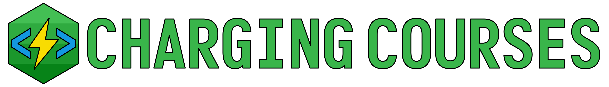

# Welcome!

Hello {{user.full_name|capitalize|there}}! My name is Caleb Vang, I am an intended computer science major at UGA. I will be teaching these courses over the next 15 weeks of this semester to prepare you for the FRC season.

This Start Here course will outline how to use Charging Courses throughout the season so please read these next few lessons thoroughly.

As always, if you have any questions or concerns, please contact us!

- Caleb Vang: [caleb.vang@uga.edu](mailto:caleb.vang@uga.edu)
- Quinn David: [futureawesomescientist@gmail.com](mailto:futureawesomescientist@gmail.com)

To continue, click on the "Next" button at the bottom right corner of this page.