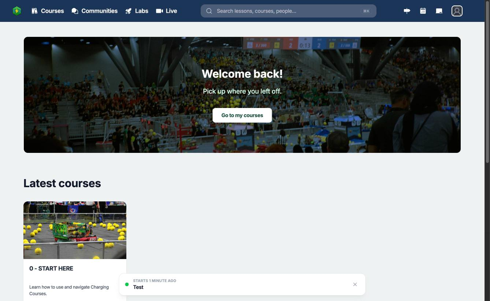

First login to Charging Courses by going to this URL: [https://chargingcourses.com/login](https://chargingcourses.com/login)

You'll be asked how you'd like to sign in. Choose **Charging Courses Auth** as this will use your central Charging Courses account to login (This is especially needed for other services like Labs). Otherwise, you can choose **Email me a login link**, enter the email you signed up with, and click the link we send to your inbox. If you don't have an account yet, please contact me at [caleb.vang@uga.edu](mailto:caleb.vang@uga.edu?subject=Charging%20Courses%20Account%20Creation).

<!-- SCREENSHOT: chargingcourses.com/login sign-in options (needs a logged-out browser) -->

Make sure you are logged in and not merely previewing the lessons. You can verify your login status by checking the top right corner. When you're logged in, the home page will say **Welcome back!** and your account icon will be next to the calendar. Clicking it shows your username, **User Settings**, and **Sign out**. If you see a login button instead, you're not logged in.

The bar at the top of every page is how you get around Charging Courses:

- **Courses** lists every course you can take.
- **Communities** is where you can discuss with other students.
- **Labs** opens your programming workspace.
- **Live** shows online classes and meetings.
- The icons on the right are your **Progress**, **Calendar**, and **Boards**, followed by your account.

You can also press **Ctrl + K** (or click the search bar) to search for any lesson, course, or person.
