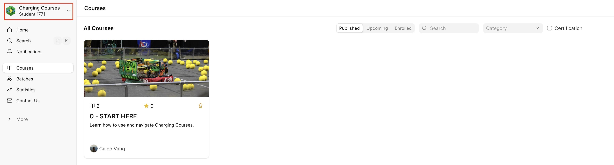

# Logging In

First login to Charging Courses via the logo drop down or by going to this URL: [https://chargingcourses.com/login?redirect-to=/lms](https://chargingcourses.com/login?redirect-to=/lms)

This should automatically forward you to <a href="https://auth.chargingcourses.com/" rel="noopener noreferrer">Charging Courses Accounts</a> which handles your account for all the software we use for this course.

Make sure you are logged in and not merely previewing the lessons. You can verify your login status by checking for a username beneath the Charging Courses Logo. If you don't see a username, you're not logged in.

