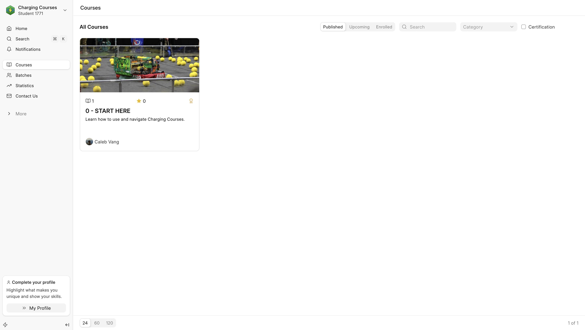
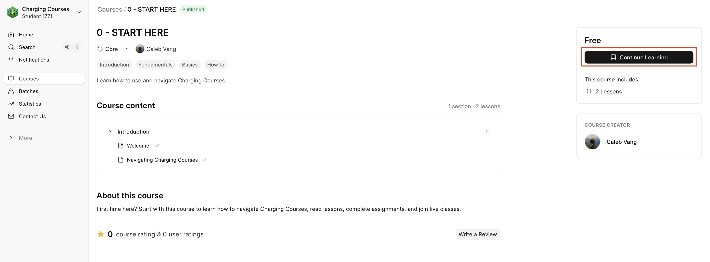
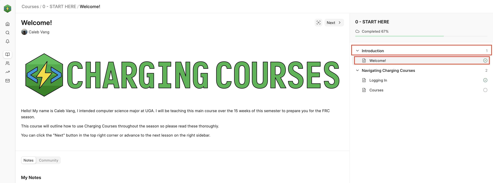
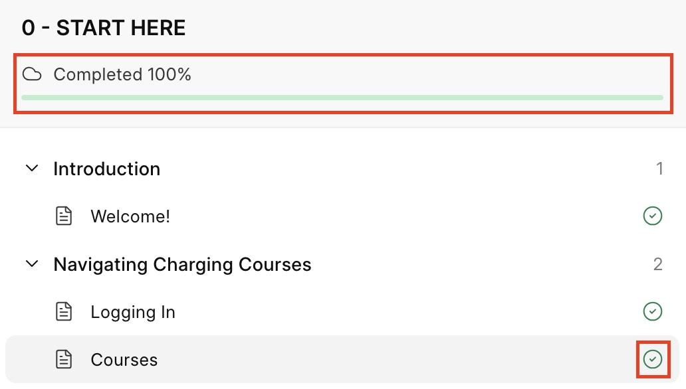
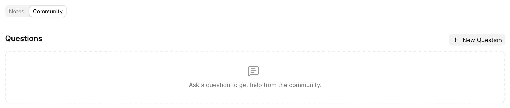
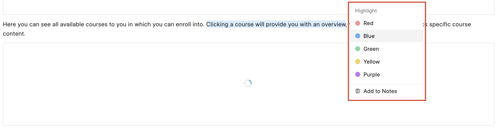

# Courses

## Content

### Introduction

Charging Courses LMS organizes its curriculum by Courses → Chapters → Lessons.

- A **Course** will contain most of the material for a topic or several topics.
   - For example, the Fundamentals course will go through the basics of Java and important programming concepts.
- A **Chapter** organizes lessons into a more structured flow.
- A **Lesson** contains actual curriculum content and is where you'll be reading and doing assignments.

### Navigating The Interface

Once logged in, you will start on the courses page which shows all available courses to you.

Here you can see all available courses to you in which you can enroll into. Clicking a course will provide you with an overview, where you can enroll or click specific course content.

Once you are enrolled into a course, there will be a sidebar on the right that lists the chapters and individual lessons. Each chapter is a drop down and can hide or show lessons within that chapter. Clicking on a lesson will open up that individual lesson to show its content on the page.

As you complete lessons, they will fill up your progress bar for the course until completion.

At the bottom of a lesson, you'll have access to your own personal notes and a comment section. Your notes you can write anything and reference them back at the same place. In the community tab, you can ask new questions and your classmates or instructors will be able to help out. This is also a great place to provide feedback to the specific lesson.

Notes and community may not be accessible if a quiz or assignment is on the same lesson.

Highlighting lesson text can allow you to highlight and reference for your notes.

Sometimes a lesson will have a quiz or assignment built in. After this lesson, there is a quiz and assignment that you can play with to see how they work. They behave exactly like
