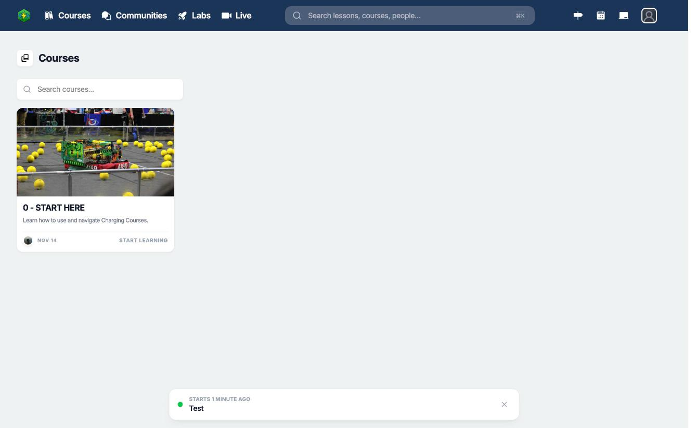
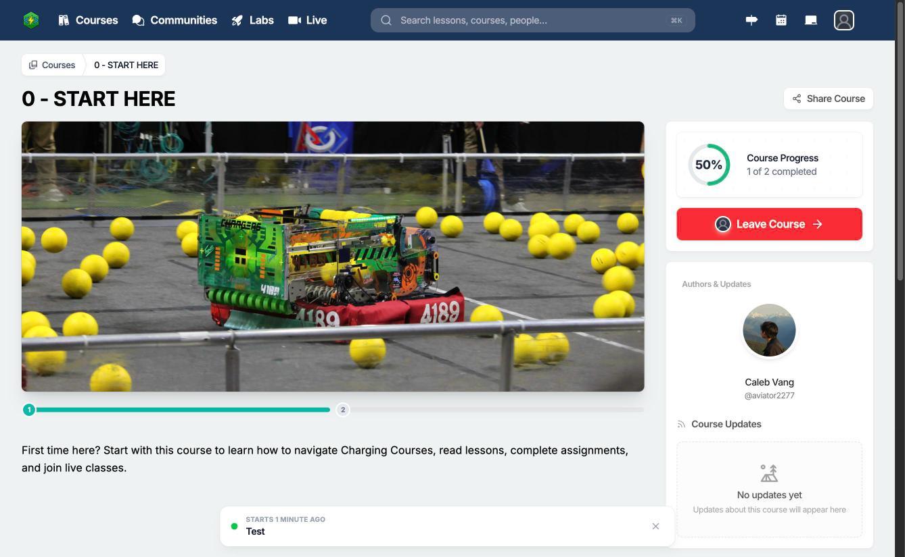
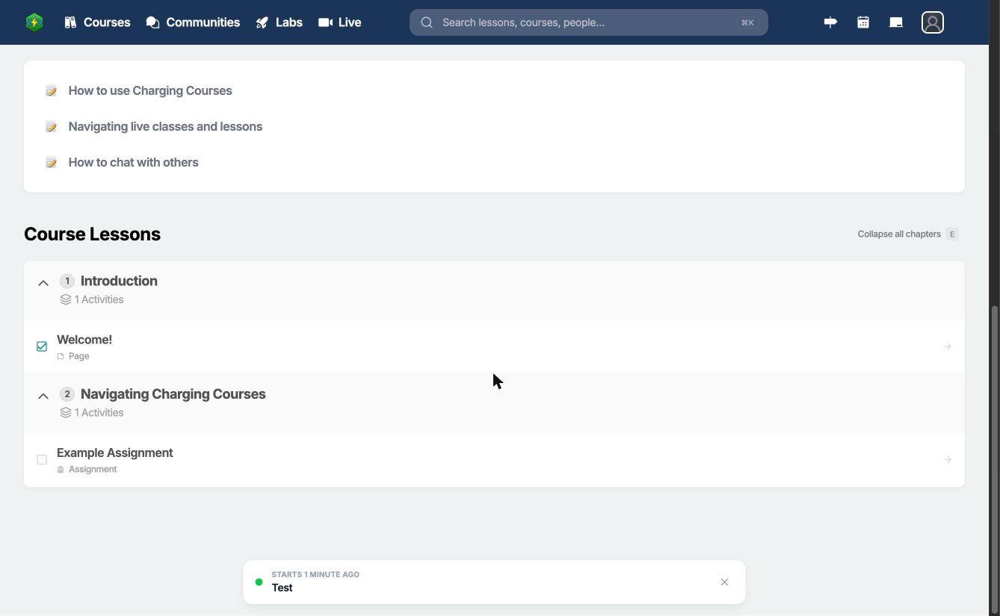
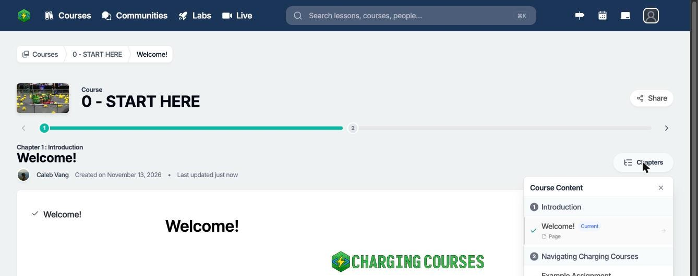
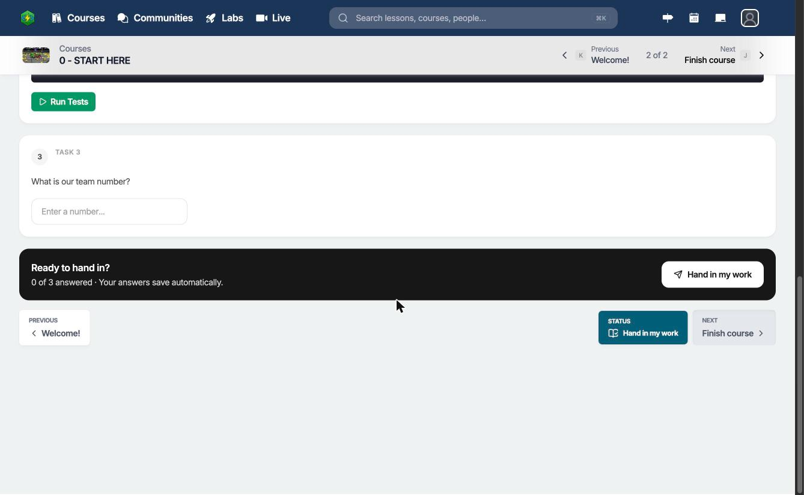

## Introduction

Charging Courses organizes its curriculum pipeline by Courses → Chapters → Lessons.

- A **Course** will contain most of the material for a topic or several topics.
   - For example, the Fundamentals course will go through the basics of Java and important programming concepts.
- A **Chapter** organizes lessons into a more structured flow.
- A **Lesson** (also called an activity) contains actual curriculum content and is where you'll be reading and doing assignments.

## Navigating The Interface

Click **Courses** in the top bar to see all courses available to you. You can search for a course by name, and clicking a course will open its overview.

The course overview shows a description, the instructors, and your **Course Progress** on the right. If you haven't joined the course yet, there will be a button to enroll there instead of **Leave Course**. Course updates from instructors will also show up on the right.

Scroll down to see what you will learn and the **Course Lessons**. Each chapter is a drop down and can hide or show lessons within that chapter. Under each lesson you'll see what type it is, like a **Page** for reading or an **Assignment**. Clicking on a lesson will open up that individual lesson.

## Inside a Lesson

At the top of a lesson, you'll see the course, the chapter, and a progress bar. Each numbered dot on the bar is a chapter, so you can jump between them. While the sectioned horizontal bar between the numbers represent each lesson in each chapter. The expand icon on the right turns on **Focus Mode**, which hides everything except the lesson.

Click **Chapters** in the top right of a lesson to see the whole course and skip to any lesson.

At the bottom of a lesson, the **Status** button marks the lesson as complete and **Next** takes you to the following lesson. As you scroll, a bar at the top will also show **Previous** and **Next**. You can use the **K** and **J** keys to move between lessons too.

As you complete lessons, they will fill up your progress bar for the course until completion. If you marked a lesson complete by accident, click the checkbox again to unmark it.

Sometimes a lesson will have a quiz or assignment built in. The next lesson goes over how they work.
