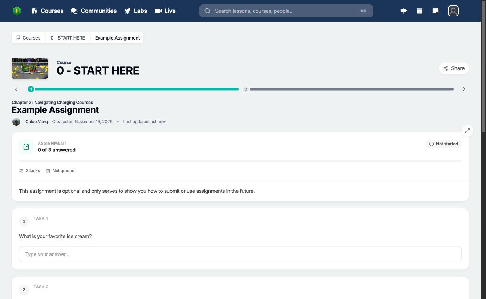
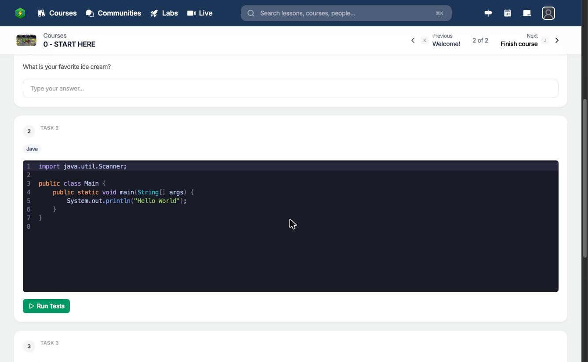
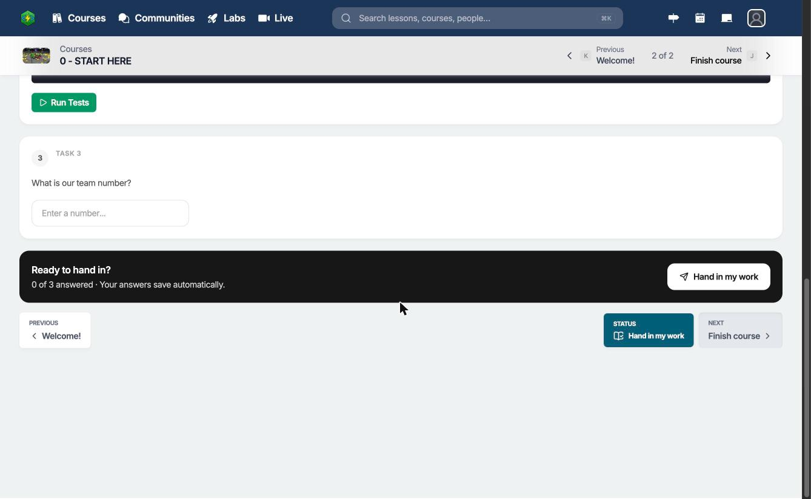

## Introduction

Some lessons are **assignments** or **quizzes** instead of reading. These are how you'll turn in homework and check what you've learned.

- An **Assignment** is made up of **tasks**. A task can be a written answer, a number, or a coding problem.
- A **Quiz** is a set of questions you answer right on the page.
- Your answers **save automatically**, so you can leave and come back later.

In this course there's an **Example Assignment** that you can play with to see how they work. It is optional and isn't graded.

## Navigating an Assignment

At the top of an assignment you'll see how many tasks there are, how many you've answered, and whether it's graded. The status in the top right will change from **Not started** to show your progress.

Each task is numbered. Type your answer in the box below the question.

Some tasks will have a code editor built in, just like your workspace. Write your code in the editor and click **Run Tests** to check if it works. You can run the tests as many times as you need.

## Handing In Your Work

When you're done, scroll to the bottom and click **Hand in my work**. You can also click the **Status** button at the bottom of the page.

Make sure you've answered every task before handing in. The bar at the bottom shows how many you've answered.

Once your work is graded, you'll be able to see your grade and any feedback on the same page.
