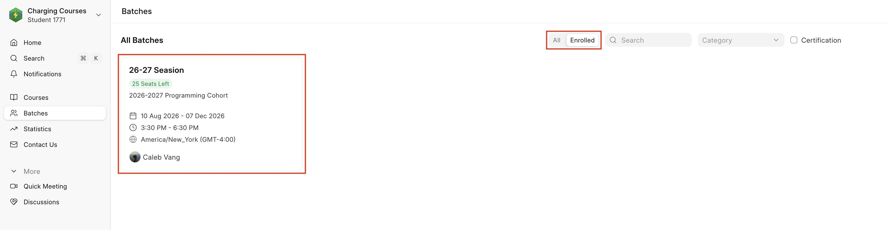
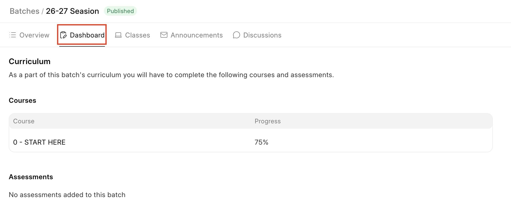
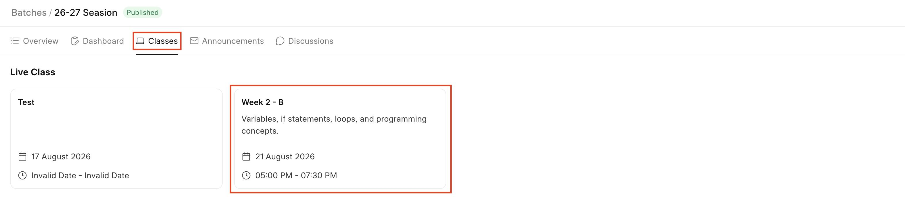

# Batches

## Introduction

Batches are essentially cohorts or class lists. They serve as the organizing structure for both classmates and online classes. Here, you can engage in discussions with students and join in online meetings. We occasionally make announcements here as well.

- **Live Class** is where we host online classes for the B session of this curriculum. When it get nears a scheduled class time, you'll be able to join the online meeting from here.
- **Announcements** is where we announce important information about the course or schedule.
- **Discussions** is where you can discuss or talk with other students. However, we advise against this and use Discord or Gameplan instead.

## Navigating The Interface

You can access batches from the left sidebar (people icon). Sometimes your batch won't show up, so you may need to select the "enrolled" tab to see your actual batches.

The dashboard will show you all courses that are recommended for you to take. Assessments here will show to test your knowledge and skills gained throughout the course.

The classes tab will show all available and upcoming live classes. This is also where you can join online meetings.

