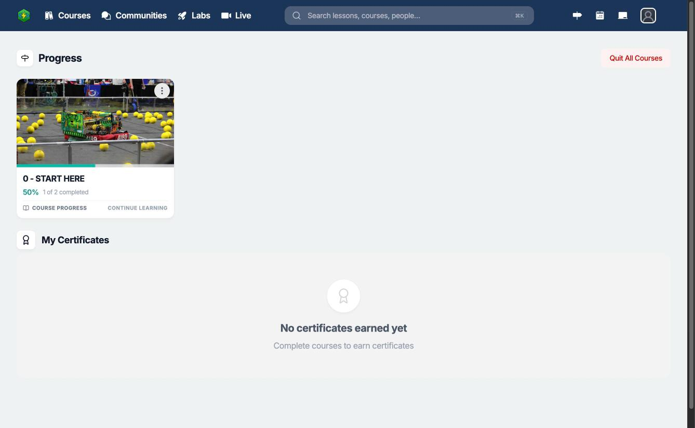
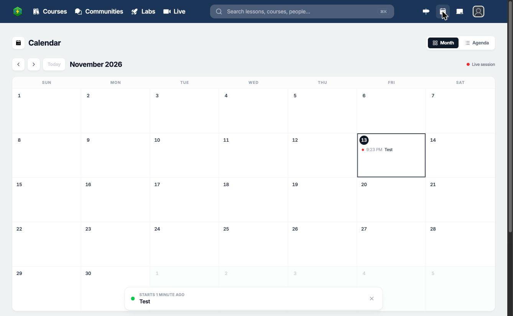
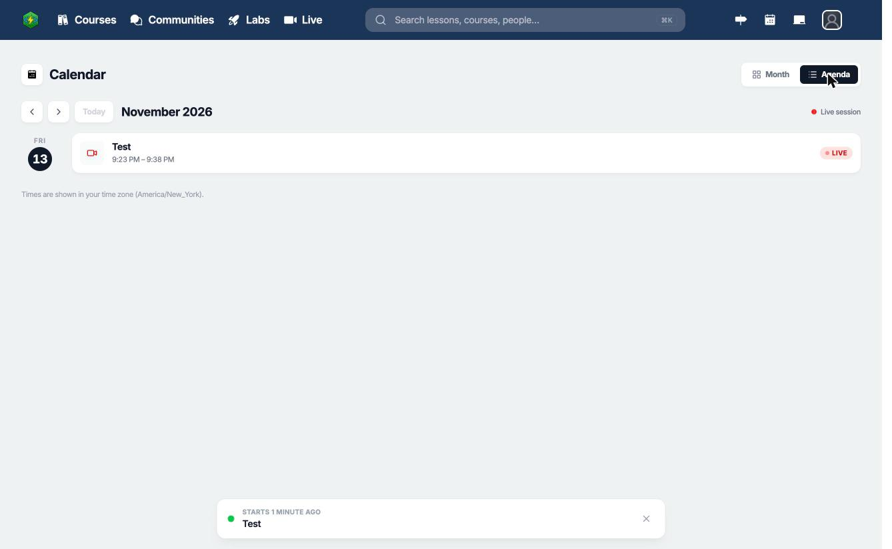
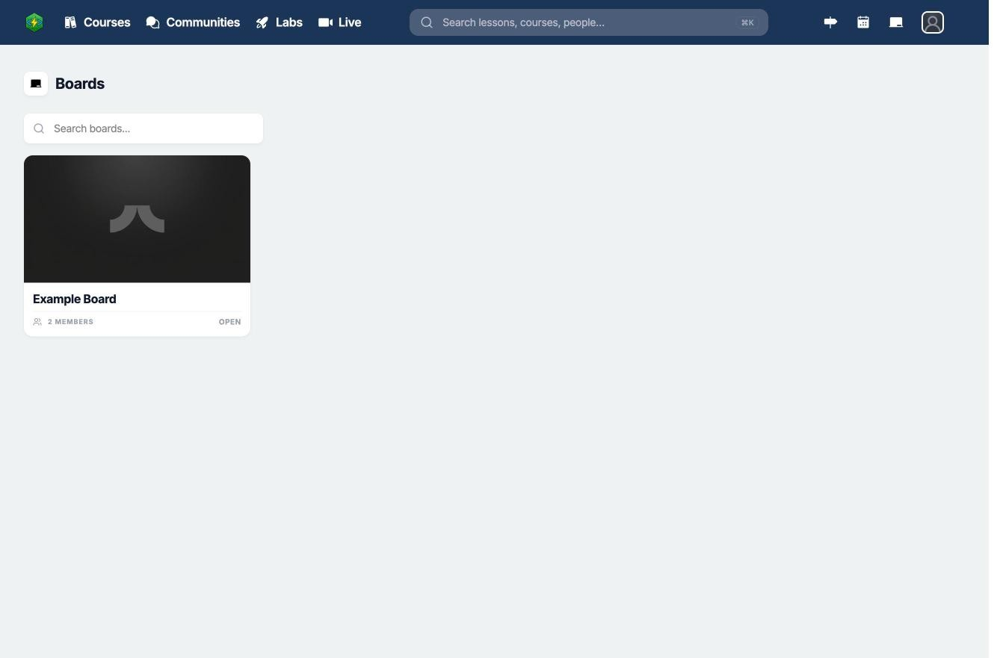
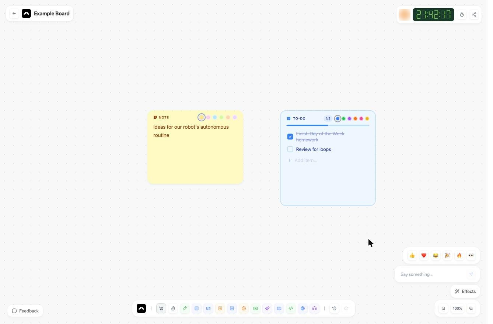
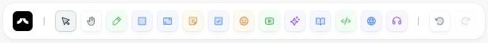

## Introduction

Your **Progress**, **Calendar**, and **Boards** pages help you keep track of where you are in the course, what's coming up, and work together with others. You can find them using the icons in the top right, next to your account.

- **Progress** shows every course you've joined and how far along you are.
- **Calendar** shows all upcoming live classes.
- **Boards** are shared whiteboards where you can plan, take notes, and brainstorm with your classmates.

## Progress

Click the signpost icon to open your progress. Each course shows a progress bar and how many lessons you've completed. Click **Continue Learning** to jump right back to where you left off.

When you finish a course, your certificate will show up under **My Certificates**.

## Calendar

Click the calendar icon to see all scheduled live classes for the month. Live sessions are marked with a red dot. Use the arrows to go between months, or **Today** to come back to the current month.

Click **Agenda** in the top right to see a list of classes instead. Times are shown in your own time zone.

## Boards

Click the board icon (the last icon before your account) to see all the boards you're a member of. Each board shows how many members it has. Instructors will add you to boards for group work, and you can search for one by name.

Click a board to open it. A board is a big canvas that everyone on it can see and edit at the same time, so anything you add shows up for your classmates right away. Drag the background (or use the **Pan** tool) to move around, and use the **+** and **-** buttons in the bottom right to zoom.

The toolbar at the bottom has everything you can add to a board:

- **Select** and **Pan** move things around and move your view.
- **Draw** lets you draw freehand.
- **Add Card**, **Frame**, and **Note** add text. Frames are good for grouping things together, and notes act like sticky notes.
- **To-do** adds a checklist. The counter at the top shows how many items are done.
- **Sticker** adds a sticker or emoji.
- **YouTube**, **Embed**, **Webpage**, and **Podcast** put videos, websites, and audio right on the board.
- The arrows on the right are **Undo** and **Redo**.

Click on anything you've added to change its color, move it, or delete it.

In the bottom right you can send a quick message to everyone on the board with **Say something...**, react with an emoji, or turn on **Effects**. In the top right, the timer button lets you **Set timer** for everyone (great for timed activities), and **Share board** gives you a link to the board.

> [!WARNING]
> Everyone on a board can see and change what you add, so be respectful of your classmates' work.
