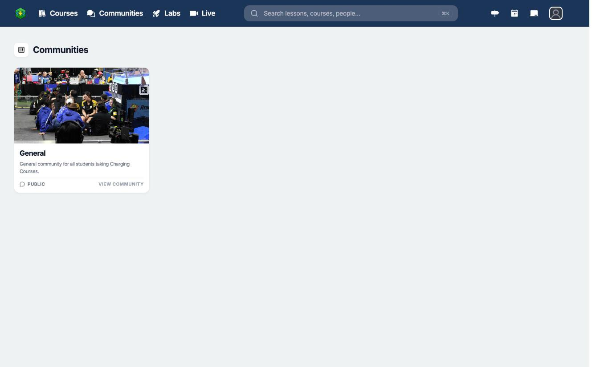
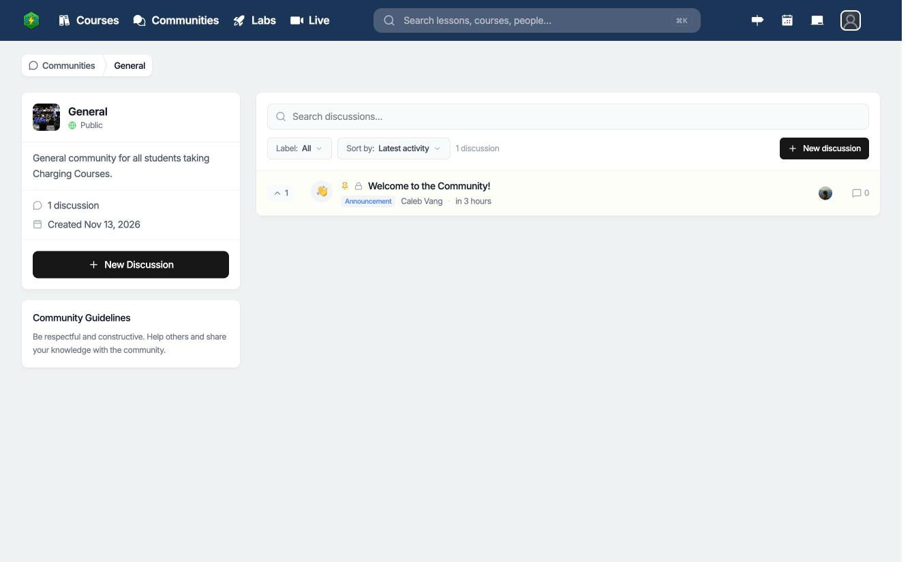
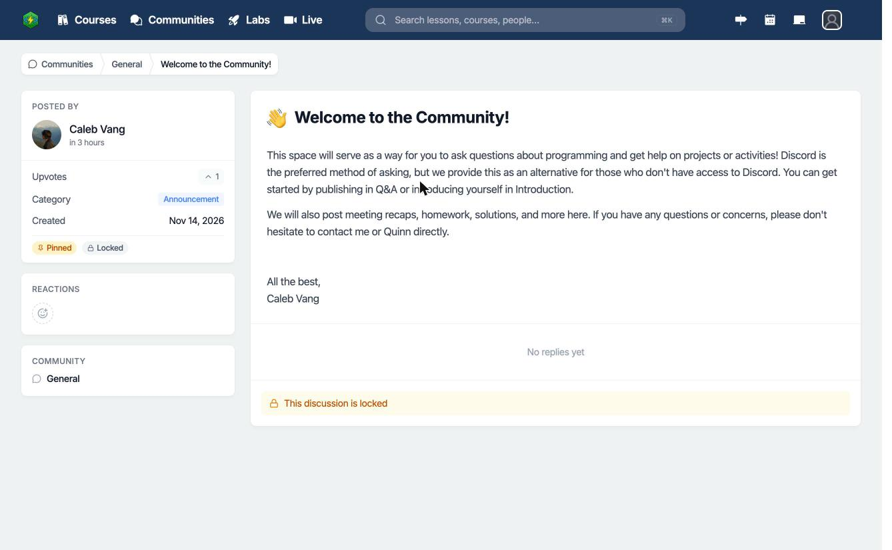
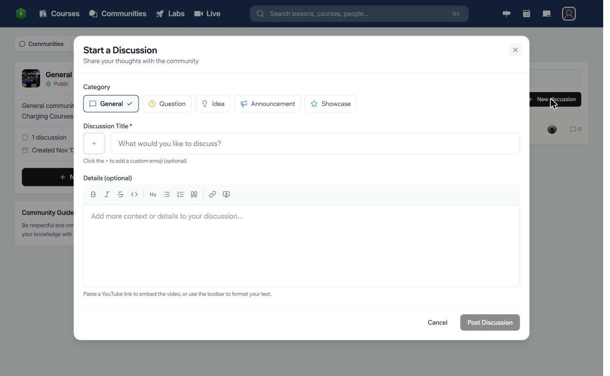

## Introduction

Communities (or also called discussions) is a place where all students can discuss about programming, problems/issues, and more. This is also where we will announce important information for those without access to Discord.

- A **Community** is a group for a class or topic. The **General** community is for all students taking Charging Courses.
- Each community has **discussions** that work like a forum post. Anyone can reply, upvote, and react.

Discord is still the preferred place to ask questions, but Communities is a great alternative if you don't have access to Discord.

## Navigating Communities

Click **Communities** in the top bar to see all communities available to you. Click **View Community** to open one.

Inside a community you'll see all of its discussions. You can search discussions, filter them by **Label**, and sort them by latest activity. Pinned posts, like announcements, stay at the top.

Click on a discussion to read it. You can upvote it with the arrow, add a reaction, and reply at the bottom. Some posts, like announcements, are **locked** and can't be replied to.

## Starting a Discussion

Click **New Discussion** to start your own. Choose a category:

- **General** for anything
- **Question** when you need help
- **Idea** for suggestions
- **Showcase** to show off something you made

Give it a title and add any details. You can format your text, add code, and paste a YouTube link to embed a video. When you're done, click **Post Discussion**.

When asking for help with code, include what you're trying to do, what you expected to happen, and the error you got. It makes it much easier for classmates and instructors to help out.
