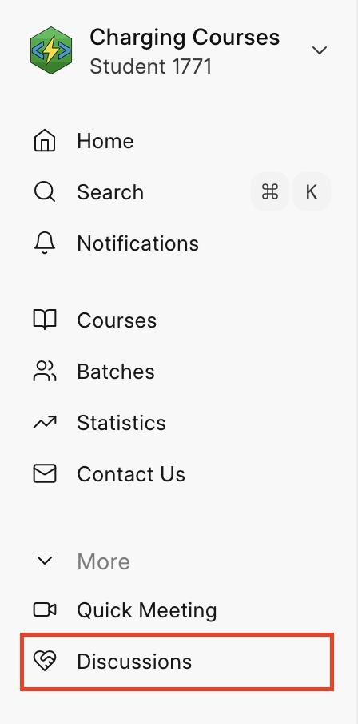
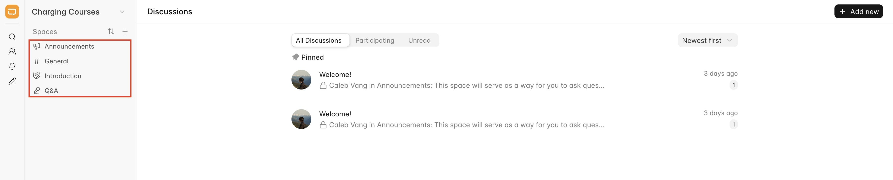

# Gameplan (Discussions)

## Introduction

Gameplan (or also called discussions) is a place where all students can discuss about programming, problems/issues, and more. This is also where we will announce important information for those without access to Discord.

- **Community** is a place where students can discuss with other classmates.
- Each community will **channels** that act exactly like discord.

## Navigating Gameplan

You can access Gameplan from Charging Courses on the left sidebar under the more category. Click on Discussions and you will be forwarded to the Gameplan dashboard.

You will be forwarded automatically to the Charging Courses community and participate within channels there. Note that you may not have full access as we have to manually add users to the community. There is no current way to go back to Charging Courses, so you can navigate to my announcement post and find your way back there.

