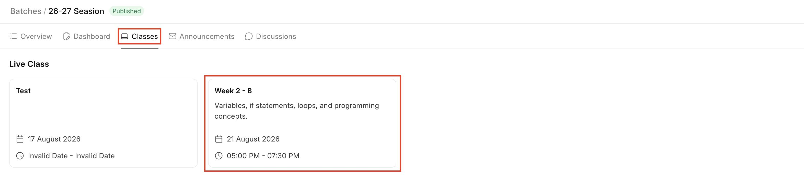
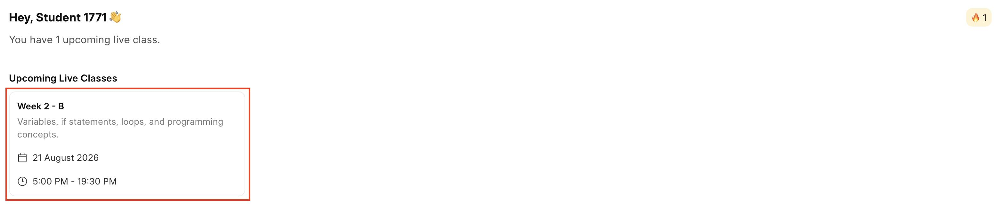
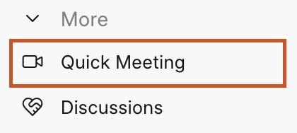
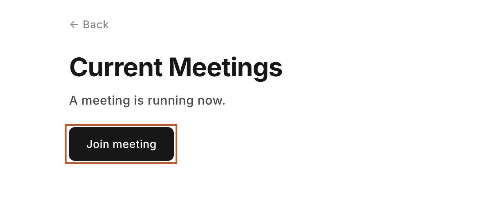

# Online Class

## Introduction

Our currently schedule is organized by weeks and sessions, with each session consisting of a lesson. Each week has two sessions: Session A is in-person on Mondays, while Session B is online on Fridays at 5:00 P.M.

- **Session A** Lecture slides will be posted online along with recorded material and comprehensive readings on the topic
- **Session B** classes will be online and recorded along with comprehensive readings
- To join, we use **PlugNMeet** as a online conferencing provider and you will be able to access this without needing an account.

## How To Join

Like mentioned before, you can join by going to your batch and clicking on the classes tab.

You can also find upcoming or current live classes on the home page.

## How To Join a Quick Meeting

If necessary, we will setup a quick meeting. This can be accessed through the sidebar. When an instructor sets one up, you can join it.

