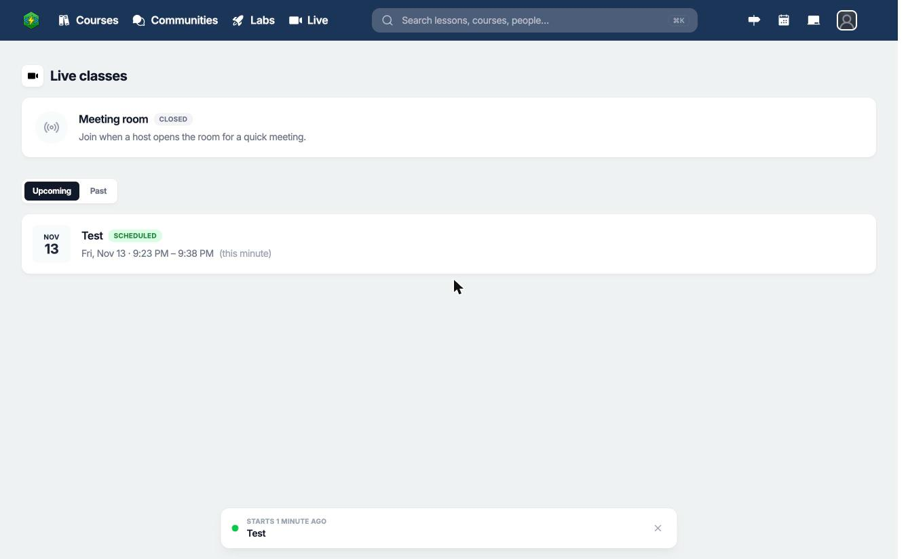
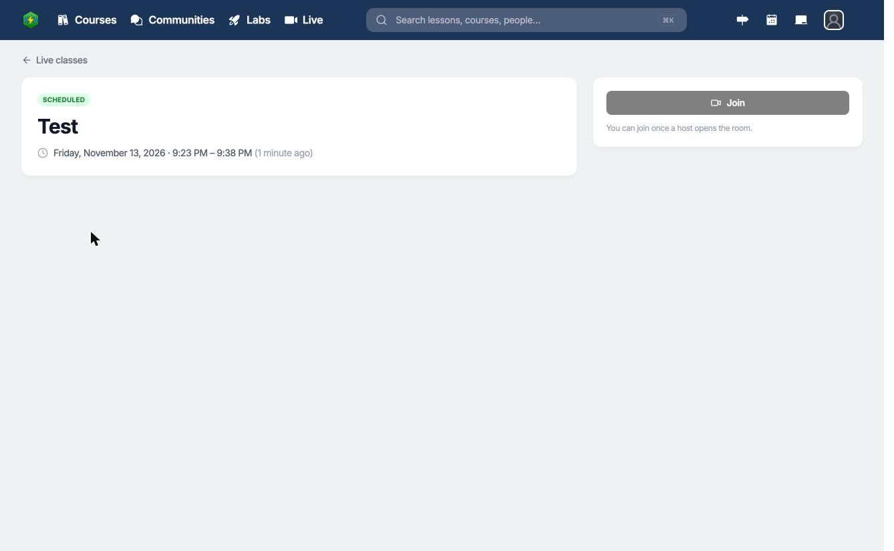
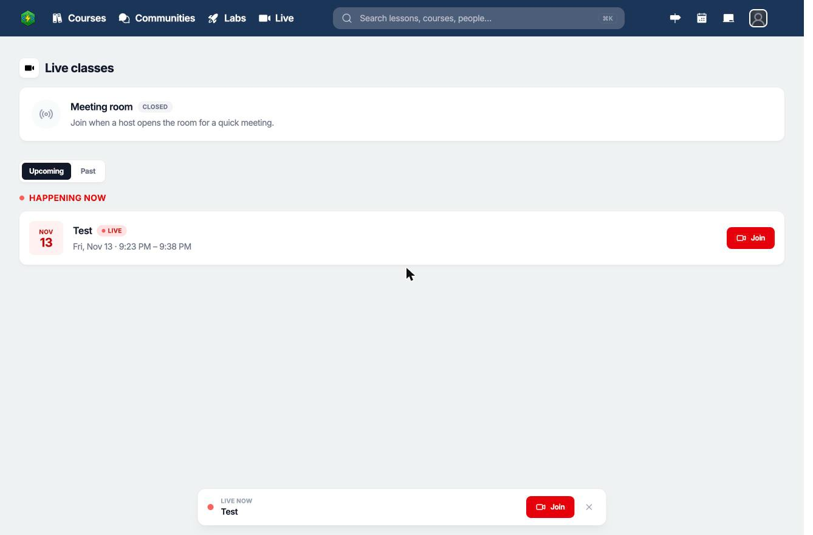
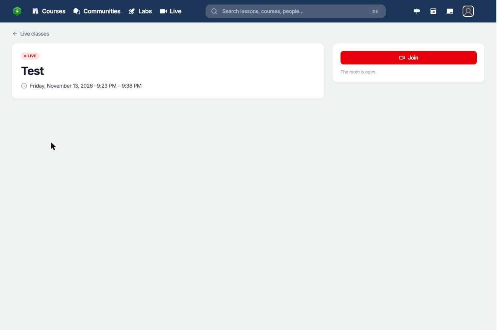
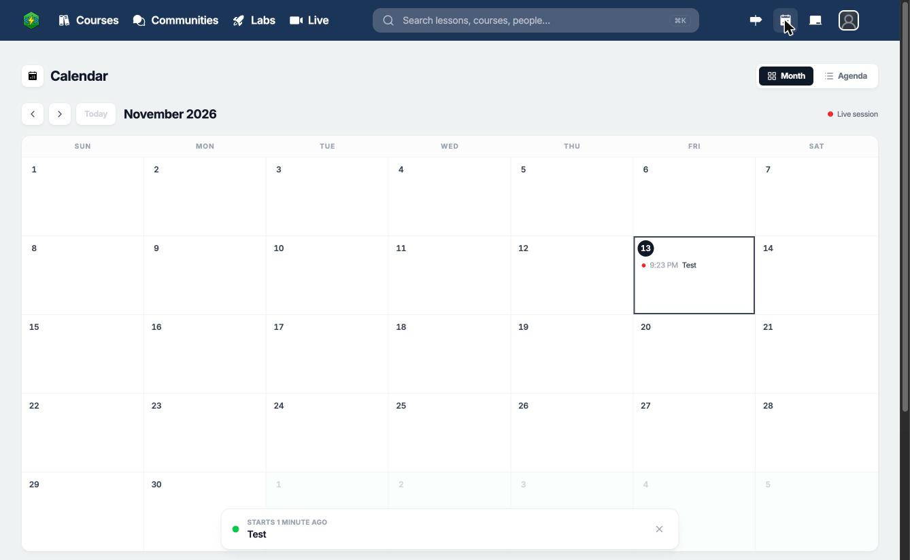

## Introduction

Our current schedule is organized by weeks and sessions, with each session consisting of a lesson. Each week has two sessions: Session A is in-person on Mondays, while Session B is online on Thursdays at 5:00 P.M.

- **Session A** Lecture slides will be posted online along with recorded material and comprehensive readings on the topic
- **Session B** classes will be online and recorded along with comprehensive readings
- To join, we use **PlugNMeet** as an online conferencing provider and you will be able to access this without needing an account.

## How To Join

Click **Live** in the top bar to see all live classes. **Upcoming** shows classes that are scheduled, and **Past** shows classes that already happened.

Click on a class to open it, then click **Join**. The Join button will only work once a host opens the room, so if it's grayed out, wait a minute and try again.

When a class starts, it moves to **Happening Now** with a red **Live** tag and a **Join** button right on the list.

You don't have to go looking for it either. When a class is coming up soon (about 10 minutes before it starts) or happening now, a banner will show at the bottom of every page on Charging Courses. Once the class is live, the banner gets its own **Join** button so you can jump right in from wherever you are.

Once the host opens the room, the class page will say **The room is open** and the **Join** button turns red. Click it and the meeting will open in PlugNMeet. See the next lesson for how to use PlugNMeet once you're in.

Live classes also show up on your calendar.

## How To Join a Quick Meeting

If necessary, we will set up a quick meeting. At the top of the **Live** page there is a **Meeting room**. It will show **Closed** until an instructor opens it. When it's open, you can join it from there.
