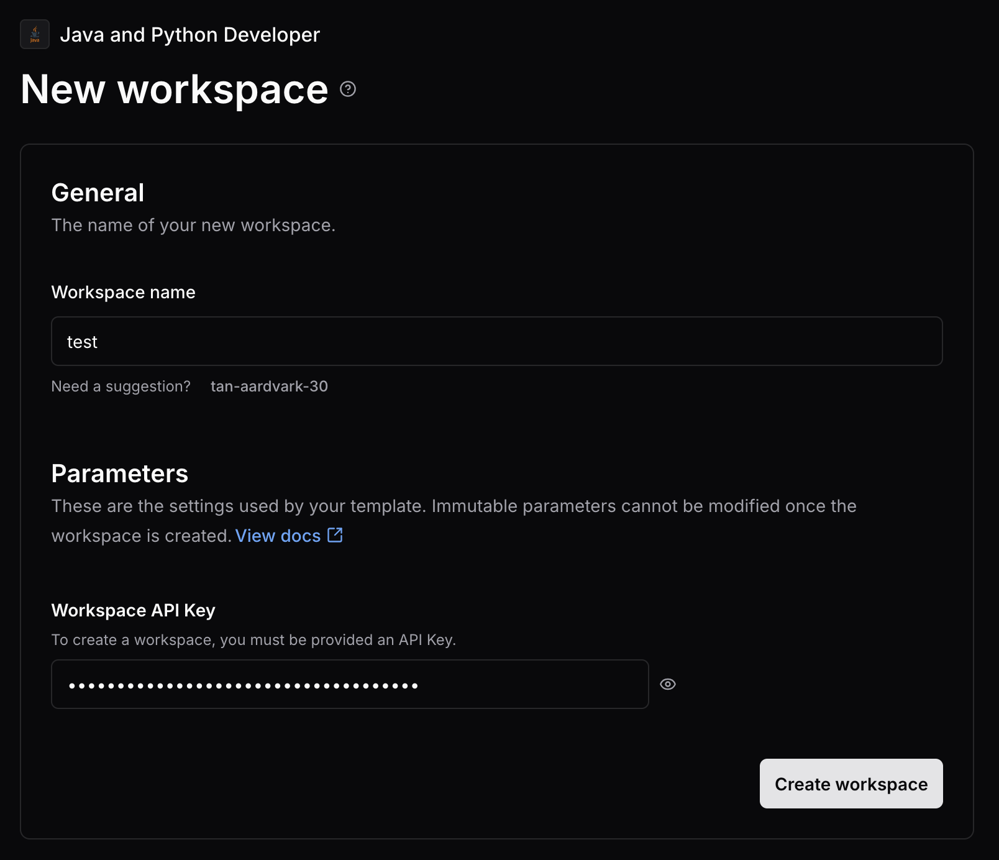
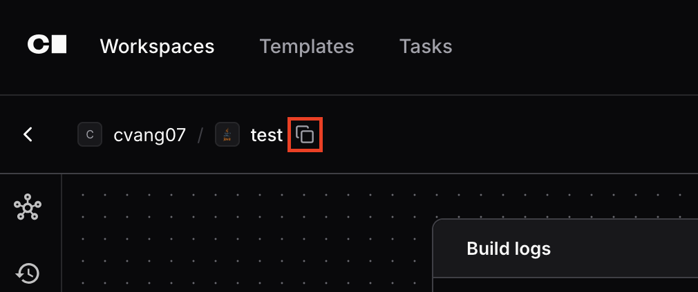
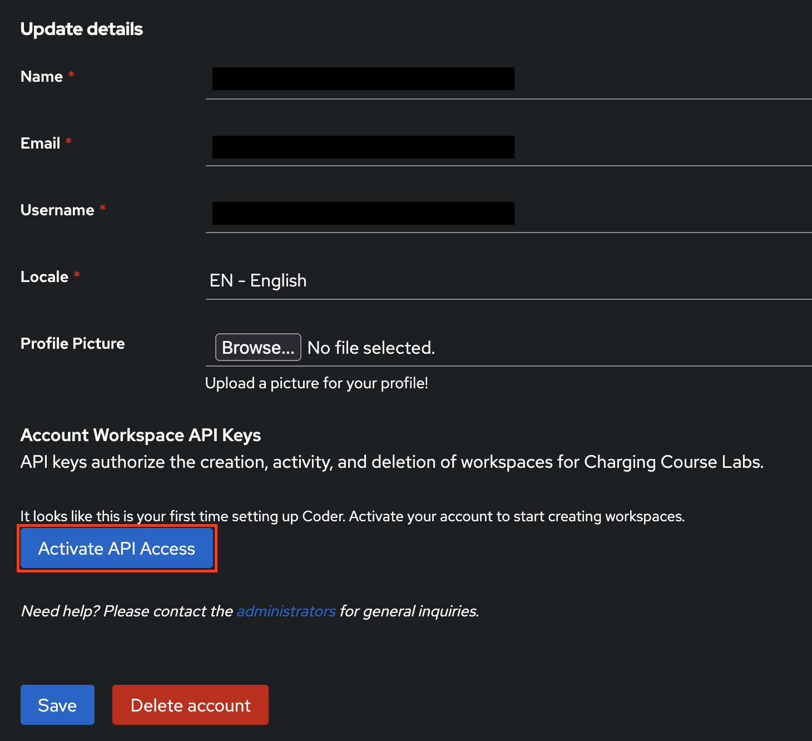
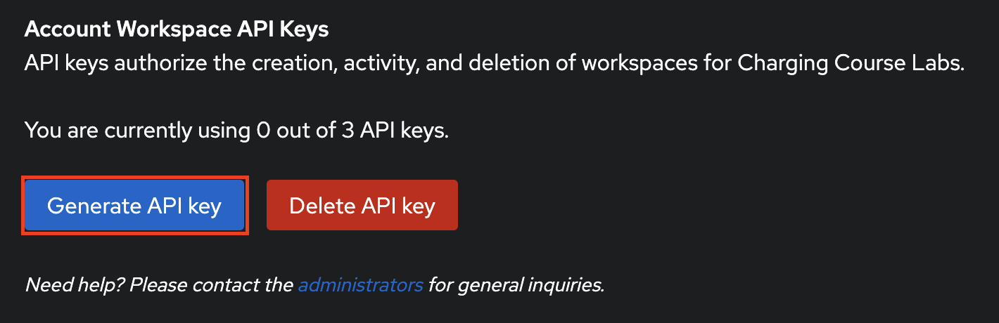
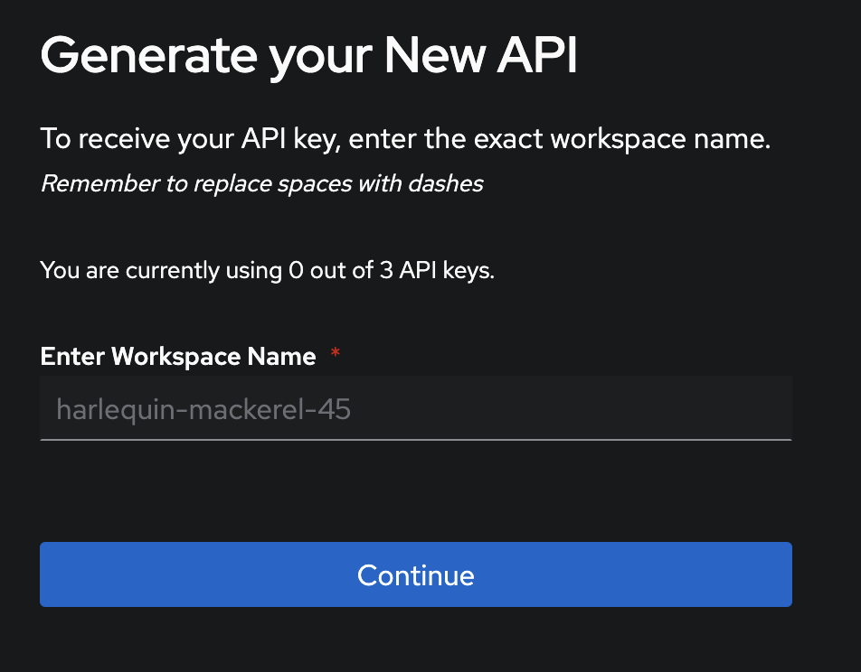
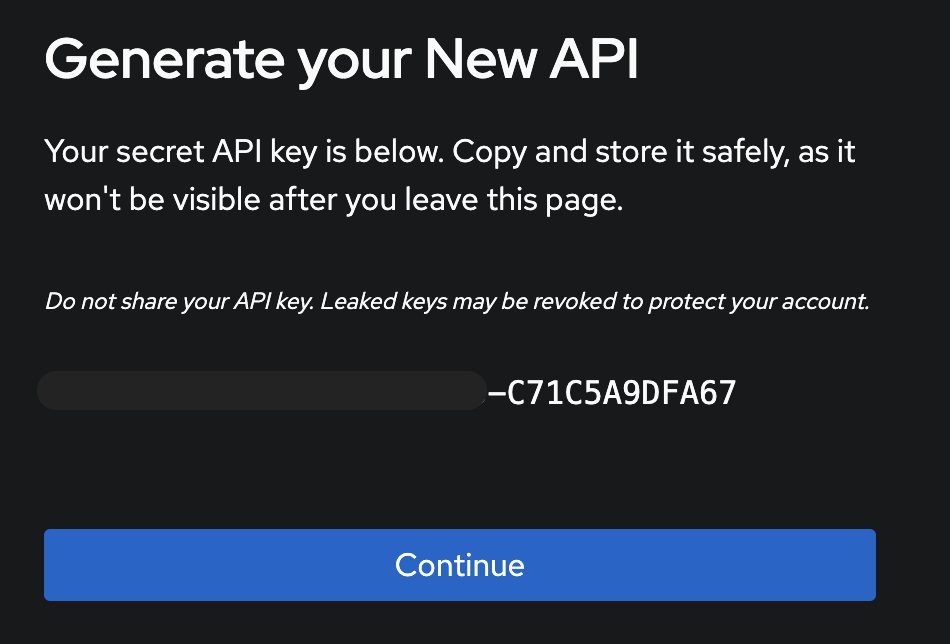
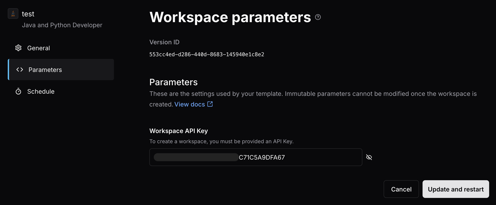
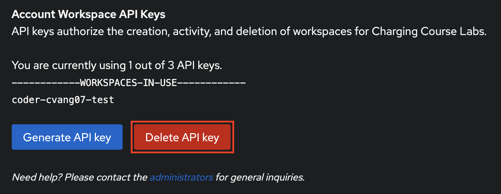
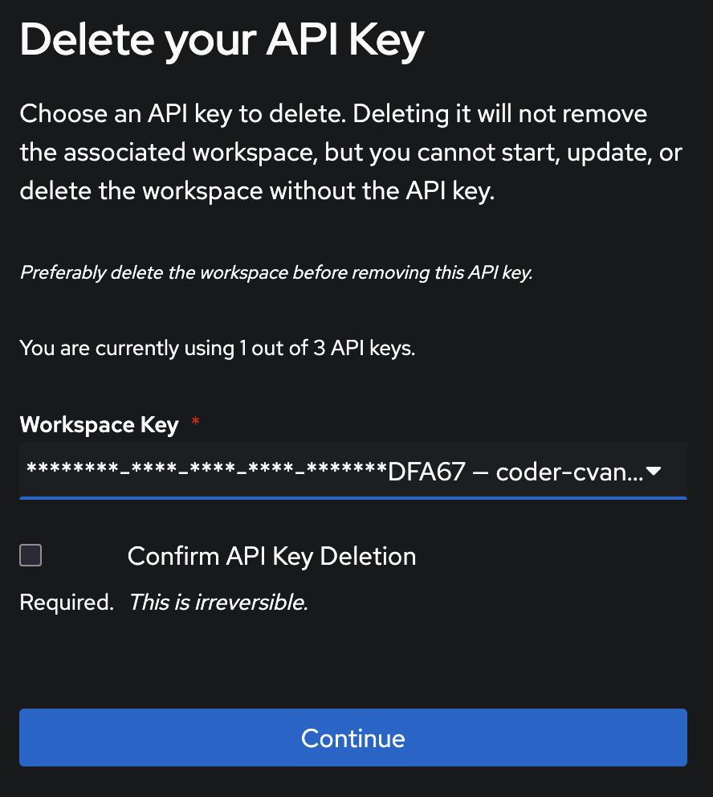

# Workspace Access

## Overview

Your Charging Courses workspace provides access to a programming editor and simulator, enabling you to program in Java and test your code. To get started, you first need to create an API key and apply it to your new workspace.

## Create a Workspace

To get started, first create a Java and Python Developer workspace here:

[Create Java and Python Developer Workspace](https://labs.chargingcourses.com/templates/aviator2277/starter-developer/workspace?mode=manual&param.Workspace+API+Key=********-****-****-****-************)

Name your workspace but **DO NOT CONTINUE**

You first need to copy your workspace name in its entirety. Note that the name can only include the alphabet, numbers, and dashes. No spaces.

If you already have a workspace, you can copy its name in the top right corner

## Activate your Account

Log into your [account settings](https://auth.chargingcourses.com/if/user/#/settings) to access your API keys. You also can access your account settings from the dashboard of Charging Courses Auth in the top right.  If you have not activated your accounts API key access, you'll be able to do so in the settings page.

To activate your account, you will need to accept the terms and guidelines.

### Generate your First API Key

After activating your account, you can now manage your API keys. You'll be able to see the amount of keys you've used and the workspaces they're currently linked to.  To generate your first API key, click "Generate API Key" to get started.

You'll have to supply your workspace name exactly. This is case sensitive and you need to replace any spaces with hyphens.

The workspace name can be obtained when you created a new workspace or by copying the name of an existing workspace in the top left corner of the dashboard. Ensure your workspace name is validated by Coder before entering it into the Charging Courses Accounts.

Once your API key is generated, copy it and store it securely. Ideally, paste it into your Coder workspace immediately. Once you leave this page, it won't be shown again.

## Use your API Key

Now you can paste your API key in the settings or when you create a new workspace. You should delete anything currently in the Workspace API Key input and paste in your new API key. Your workspace can now be started, updated, and deleted.

## Deleting an API Key

At the end of the course, if you no longer want your workspace, you can delete it and delete the API key.

Log into your [account settings](https://auth.chargingcourses.com/if/user/#/settings) to access your API keys.

Here you can preview all the workspaces that are tied to your API keys. Click on "Delete API key" to select which API key you want to delete.

When an API key is deleted, the workspace associated with it can no longer start or update. You will have to create a new API key and link it to the workspace to regain access to the workspace. Select the desired API key, then click the checkmark to confirm deletion. This is irreversible.

