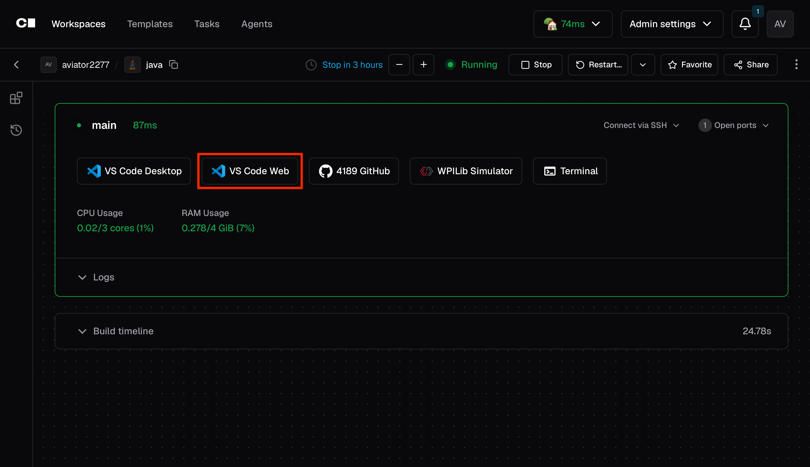
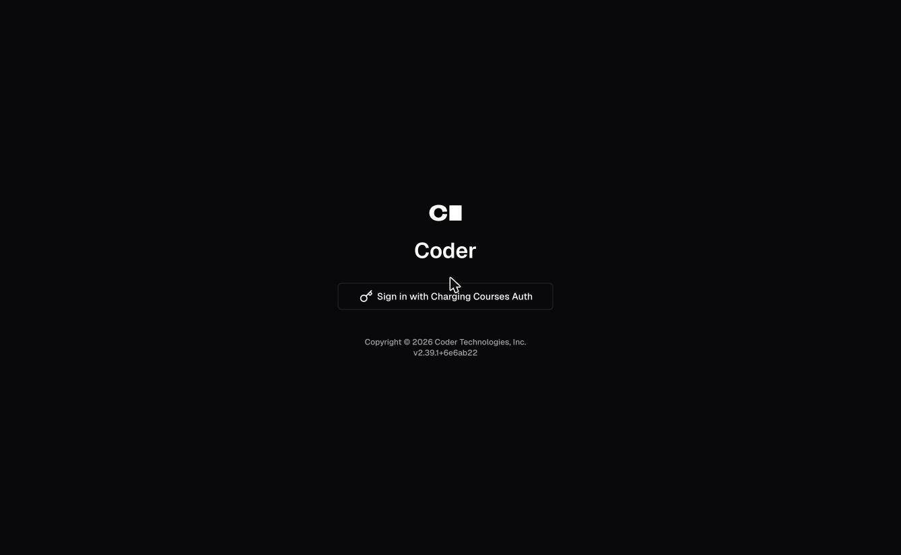
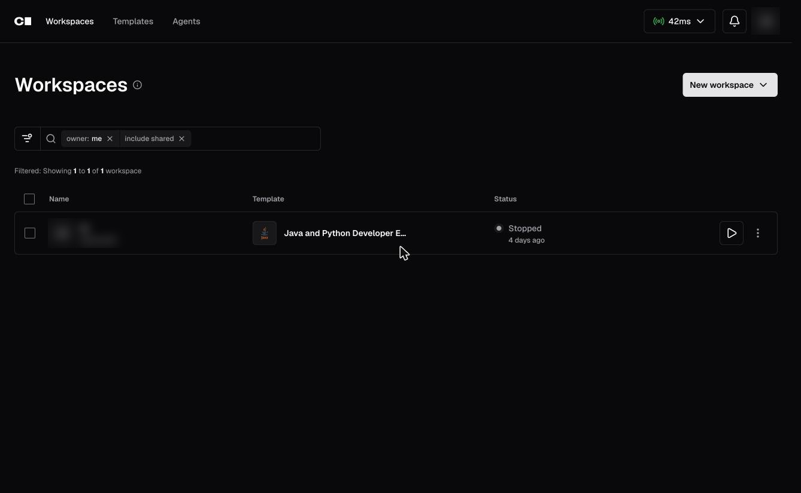
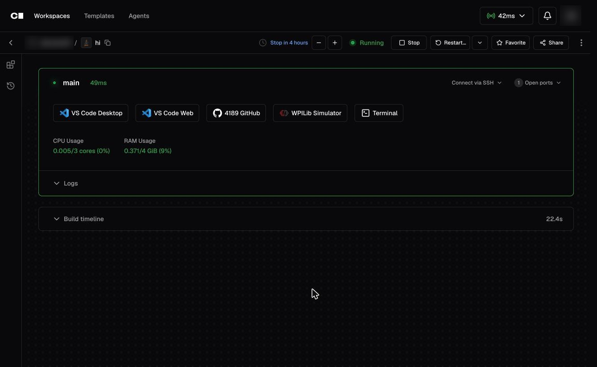
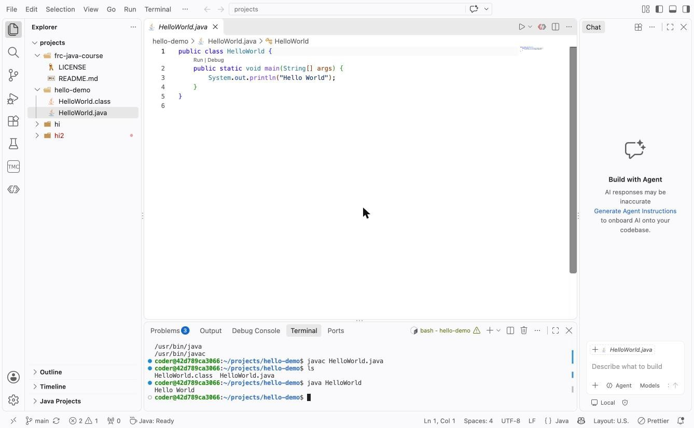
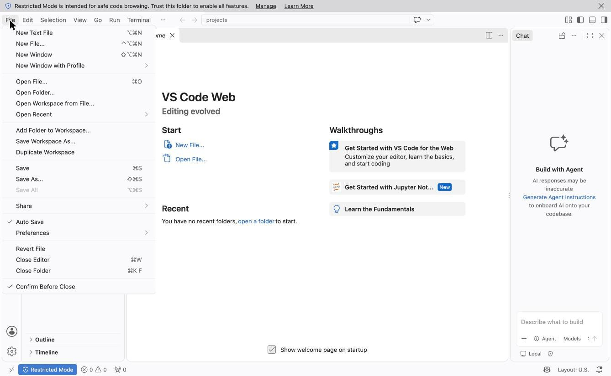
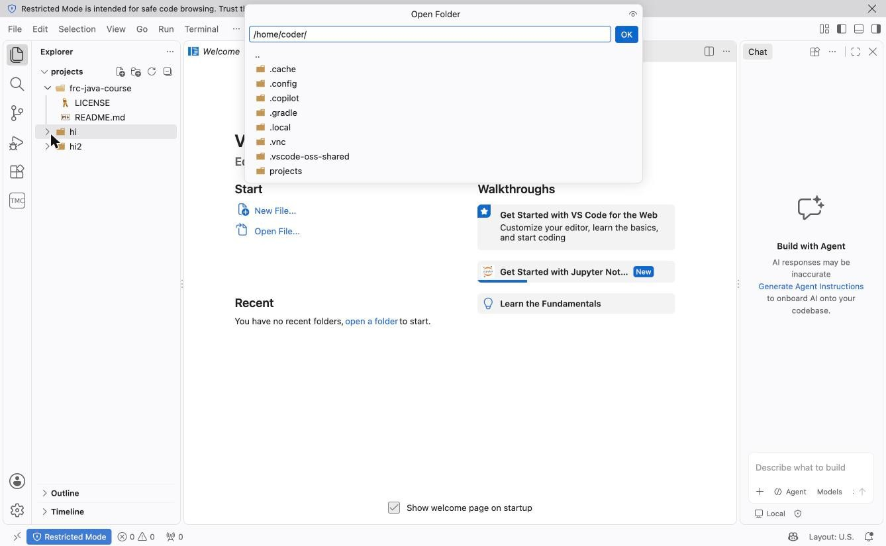
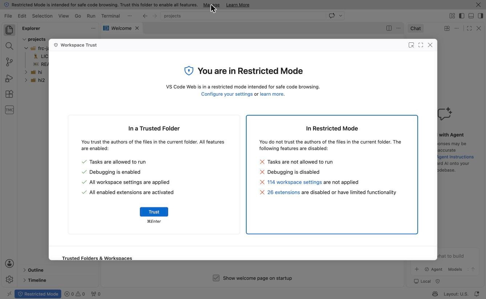
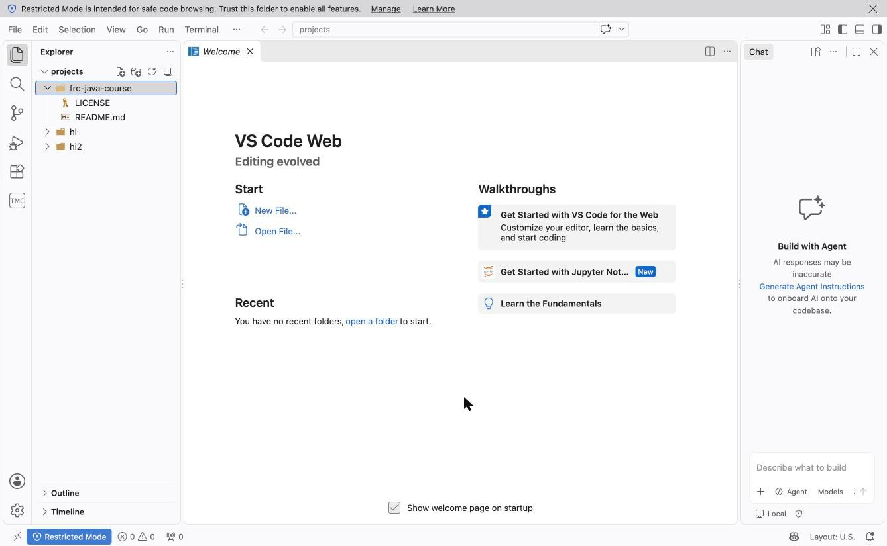
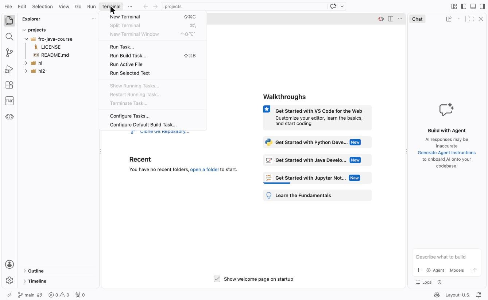

> **Objectives**
> - Start your workspace and open VS Code in the browser
> - Find your way around VS Code: Explorer, Editor, Terminal
> - Create, rename, and delete files and folders
> - Open a folder and use the terminal to run a Java program
>
> **Prerequisites:** A Charging Courses workspace with your API key added (see [Workspace Access](../03-workspace-access/lecture.md))

## Overview

Your workspace is essentially another machine that you can use to program. We provide this workspace so that you can program on a Chromebook, which usually doesn't allow programming editors. This also helps you get accustomed to the software that we use regularly on the robot.

Your workspace runs on **Coder**, and you'll write code in **VS Code**, the same editor we use for the robot, running right in your browser.



## Starting Your Workspace

1. Go to [Charging Courses Labs](https://labs.chargingcourses.com/workspaces) (or click **Labs** at the top of Charging Courses). If you're asked to sign in, click **Sign in with Charging Courses Auth**.



2. You'll see a list of your workspaces. Click on your workspace to open it. If it says **Stopped**, you can also click the ▷ button on the right to start it.



3. If your workspace is stopped, click **Start**. It takes a minute or two to boot up.
4. Once it shows **Running**, the buttons to open your apps will become available.



Your workspace will stop on its own after a while (the timer next to **Running** shows when, and **+** gives you more time). That's okay! Your files are saved, just start it again.

## Opening VS Code

On your workspace page, click **VS Code Web**. VS Code will open in a new browser tab.

The other buttons on your workspace page:

- **VS Code Desktop** opens your workspace in the VS Code app, if you have it installed on your own computer.
- **4189 GitHub** takes you to our team's code on GitHub.
- **WPILib Simulator** opens the robot simulator. We'll use this later in the season.
- **Terminal** opens a terminal by itself without the editor, which is handy if you only need to type a quick command.

## A Tour of VS Code



- **Menu Bar** (top): the **File**, **Edit**, **View**, **Run**, and **Terminal** menus. If your window is small, they hide behind a **☰** icon in the top left.
- **Activity Bar** (far left): icons to switch views. The top one, the two pages, is the **Explorer**.
- **Side Bar**: shows the current view. The Explorer lists the files and folders you have open.
- **Editor** (middle): where you write code. Each open file gets its own tab.
- **Panel** (bottom): holds the **Terminal**, plus problems and output messages.
- **Status Bar** (very bottom): small details like the line you're on and the language of the file. **Java: Ready** means Java has finished loading.
- **Chat** (right): an AI assistant. You can close it with the **X** in its top right corner to get more room.

## Opening a Folder

VS Code works with one folder at a time. Everything you see in the Explorer is inside that folder.

When you first open VS Code Web, it opens your **projects** folder (`/home/coder/projects`). This is a good place to keep all of your work.

To open a different folder:

1. Click **File > Open Folder...**



2. Type or pick the folder you want (your home folder is `/home/coder`) and click **OK**.



### Restricted Mode

The first time you open a folder, you may see a bar at the top that says **Restricted Mode**. In restricted mode, VS Code turns off features like running and debugging your code.

Click **Manage** on that bar, then click **Trust**. It's your own folder, so it's safe to trust.



## Creating Files and Folders

Hover over the Explorer and you'll see a row of icons next to the folder name:

- **New File...** creates a file
- **New Folder...** creates a folder
- **Refresh Explorer** and **Collapse Folders in Explorer** tidy up the view



The new file or folder is created inside whichever folder you have selected. You can also **right-click** a folder and choose **New File...** or **New Folder...**

Name your files with their format at the end. For Java, that's `.java`, for example `HelloWorld.java`. We'll see why the name matters when we write our first program.

### Renaming and Deleting

Right-click a file or folder in the Explorer:

- **Rename...** (or select it and press **F2**)
- **Delete** (it will ask you to confirm)

You can also drag and drop files to move them into a different folder.

## Saving Your Work

- Your workspace has **Auto Save** turned on, so your files save as you type. You can check by opening the **File** menu and looking for a check mark next to **Auto Save**.
- You can still press **Ctrl + S** to save right away.
- A **dot** on a file's tab means it has unsaved changes.

Your program runs whatever was **saved**, not what's on your screen. If your changes aren't showing up when you run, save first!

## The Terminal

The terminal lets you type commands to the computer instead of clicking.

- Open one with **Terminal > New Terminal**, or press **Ctrl + `** (the backtick key, left of 1)
- It opens at the bottom, in the folder you have open



The text before the `$` tells you which folder you're in. `~` is short for your home folder, so `~/projects` means `/home/coder/projects`.

A few commands to start with:

| Command | What it does |
|---|---|
| `pwd` | Shows which folder you're in |
| `ls` | Lists the files and folders in the current folder |
| `cd folderName` | Moves into a folder |
| `cd ..` | Moves back up one folder |
| `mkdir folderName` | Creates a folder |
| `clear` | Clears the terminal screen |

Press **Tab** while typing a file or folder name and the terminal will finish it for you.

## Running Java

Once you've written a program (we'll write our first one soon), run it from the terminal in the same folder as the file:

```bash
javac HelloWorld.java   # compiles: creates HelloWorld.class
java HelloWorld         # runs it
```

You can also do both in one step with `java HelloWorld.java`.

Once **Java: Ready** shows in the status bar, you can also click the **Run** button (▷) at the top right of the editor, or the small **Run** link right above your class. The output shows up in the terminal.


## Getting Course Files

Lesson files and exercises can be downloaded right into your workspace with `ccm`:

```bash
ccm list                    # see all courses and lessons
ccm get hello-world         # download a lesson into the current folder
ccm test                    # check your exercise, from inside its folder
```

If `ccm` isn't installed yet:

```bash
curl -fsSL https://raw.githubusercontent.com/Chargers-4189/cc-curriculum/main/install.sh | bash
```

### Keep Your Downloads Organized

`ccm get` puts files in whatever folder your terminal is in, so it's easy to end up with a messy home folder. Make a few folders first and download into them. For example, one for the course, one per week, and one for homework:

```
fundamentals/
├── week1/
├── week2/
│   ├── hello-demo/
│   └── variables-demo/
└── hwk/
    └── day-of-week/
```

```bash
mkdir -p fundamentals/week2 fundamentals/hwk   # -p creates the parent folder too
cd fundamentals/week2
ccm get hello-demo
```

You can also download straight into a folder without moving there first, using `-o`:

```bash
ccm get day-of-week -o fundamentals/hwk
```

Any layout works, as long as you can find your work later. `ccm test` finds your exercise wherever you put it.

## Chromebook Tips

- Some shortcuts belong to the browser, not VS Code. **Ctrl + W** closes your browser tab instead of a file, so close files with the **x** on their tab.
- If a shortcut doesn't work, use the **Command Palette** instead: **Ctrl + Shift + P**, then type what you want to do (for example "new terminal").
- **Ctrl + P** quickly opens any file by typing its name.
- **Ctrl + B** shows or hides the Side Bar if you need more room.

## Review

- How do you open VS Code from your workspace?
- Where do you look to see and create files?
- How can you tell a file has unsaved changes?
- How do you open a terminal, and what does `ls` do?
- What two commands compile and run `HelloWorld.java`?
