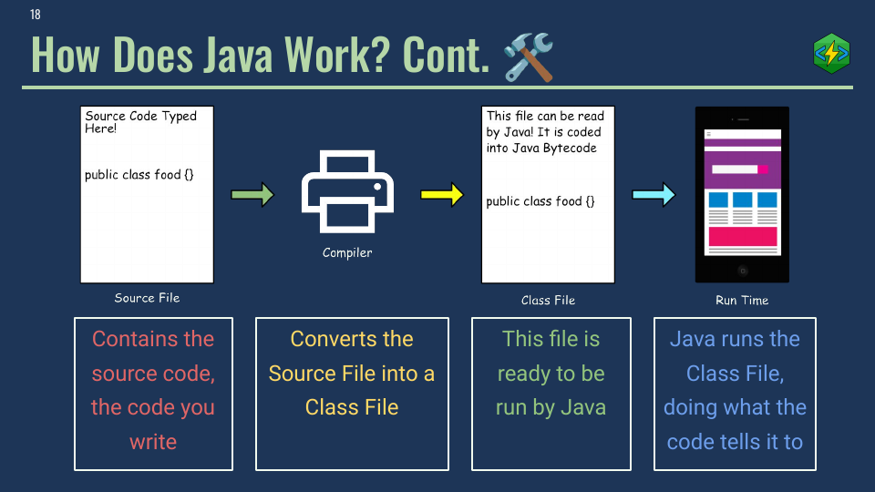
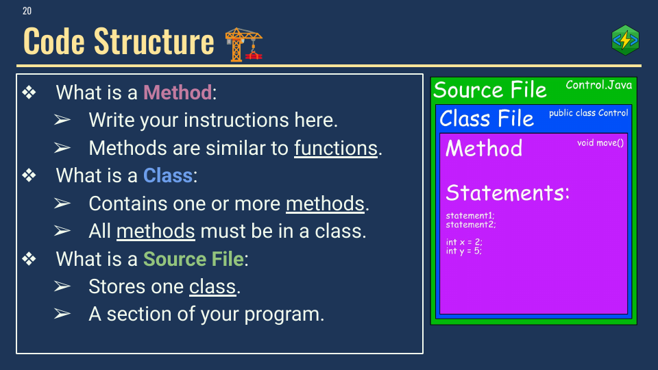
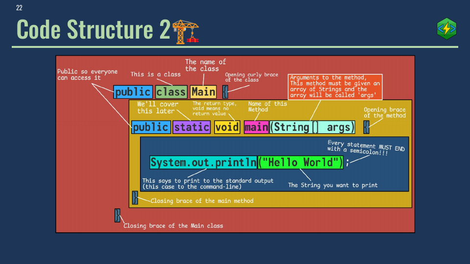

# How Java Works

## Objectives

- Know what Java is and where it's used
- Explain Java's four steps: source file, compiler, class file, runtime
- Identify the parts of a Java program: source file, class, method
- Know why every program needs a `main` method

## Prerequisites

- [Basics of Computers](../../01-getting-started/05-basics-of-computers/lecture.md): files and folders
- [Java Workspace](../../01-getting-started/04-java-workspace/lecture.md): opening VS Code and a terminal

## Content

### What is Java?

- Java is a programming language created by Sun Microsystems (now Oracle) in 1995
- It's a popular **high-level** language, meaning it's written for people to read, not just machines
- Java is used by over 3 billion devices
- Java follows the **WORA** principle: "Write Once, Run Anywhere"
  - Your code runs on any machine with a **Java Virtual Machine (JVM)**

Java is also the language we program our robot in!

### Real World Applications

**Android OS** is a mobile operating system that heavily relies on Java for application development.

- The WORA principle allows developers to write once for a wide range of Android devices
- The popularity of Java resulted in millions of applications
- This shows the power of Java in **cross-platform** development

### How Does Java Work?

Java has 4 main steps:

**Source File ► Compiler ► Class File ► Runtime**

- **Source File:** This is where all the code you write is stored. It ends in `.java`.
- **Compiler:** The compiler turns the source file into something that Java can understand.
- **Class File:** This is the output of the compiler, written in **bytecode**, which Java can read. It ends in `.class`.
- **Runtime:** The class file is read and run by the Java Virtual Machine (JVM), doing what the code tells it to do.



### Seeing It in Your Workspace

You can watch every step happen in your terminal:

```bash
javac HelloWorld.java    # Compiler: reads the source file...
ls                       # ...and creates HelloWorld.class next to it
java HelloWorld          # Runtime: the JVM runs the class file
```

When you click **Run** in VS Code, it does these same two steps for you: it compiles your source file into a class file, then runs the class file.

### Code Structure

- **Source File**
  - Stores one class
  - A section of your program
- **Class**
  - Contains one or more methods
  - All methods must be in a class
- **Method**
  - Where you write your instructions (statements)
  - Methods are similar to functions

Think of it as boxes inside boxes: a source file holds a class, a class holds methods, and methods hold your statements.



Here is what that looks like in code:

```java
public class Main {
    public static void main(String[] args) {
        System.out.println("Hello World");
    }
}
```



- `public class Main` - the name of the class. `public` means everyone can access it.
- `public static void main(String[] args)` - the name of the method, `main`. We'll learn what `static`, `void`, and `String[] args` mean later.
- `System.out.println("Hello World");` - a statement: print "Hello World" to the standard output (the terminal).
- `{` and `}` - curly braces open and close the class and the method.
- Every statement must end with a **semicolon** `;`

### The main() Method

- Everything goes in a class inside a source file
- Running a program tells the JVM on your computer to automatically **execute the main() method**
- The `main()` method is where the program **starts**
- All programs **need** a `main()` to start, no matter the size of the program

## Review

- What does WORA stand for, and what makes it possible?
- What are Java's four steps? What does each one produce?
- What file does the compiler create from `Main.java`?
- What holds what: source file, class, method?
- Where does every Java program start?
