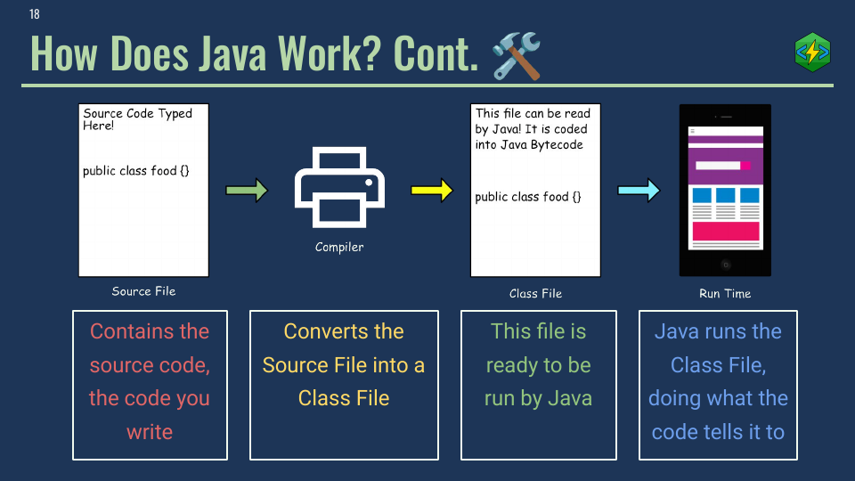
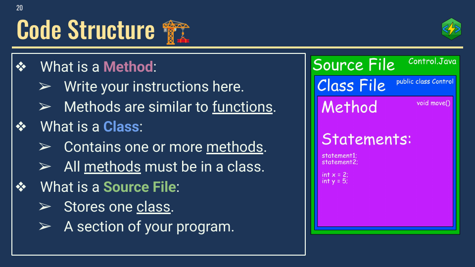
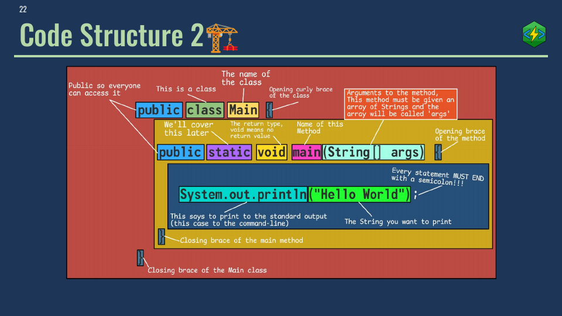

<!-- Original deck: Week 1A - Introduction (August 10, 2026), slides 21-33 -->

## Objectives! 👉

- Learn how Java works
- Understand Java Code Structure
- Learn Java Syntax
- Use Variables, Conditionals, and Loops in Java
- Use appropriate Java data types
- Take input from the user
- Output to the user

*If you are stuck or have questions, don't hesitate to ask!*

---

# Java

---

## What is Java? 💻

- Java is a programming language created by Sun Microsystems (Oracle now) in 1995.
- Popular **high-level** language
- Java is used by over 3 billion devices
- **WORA Principle**, "Write Once, Run Anywhere"
  - Runs on any machine with a Java Virtual Machine (JVM)

---

## Real World Applications 🌎

- Android OS
  - A mobile operating system that **heavily relies** on Java for application development
  - **WORA Principle** allows developers to write for a wide range of Android devices.
  - The popularity of Java resulted in **millions of applications**
  - This illustrates the power of Java in **cross-platform development**

---

# How Does Java Work

---

## How Does Java Work? 1 🛠

- Java has 4 main steps:
  - **Source File ► Compiler ► Class File ► Runtime**
- **Source File:** This is where all the **code** you write is stored.
- **Compiler:** The Compiler turns the **source file** into something that Java can understand.
- **Class File:** This is **the output of the compiler** in bytecode, which Java can read.
- **Runtime:** The class file is read and **run** by Java Virtual Machine (JVM)

---



---

## How Does Java Work? Cont. 🛠

Breakdown of how your workspace runs our code!

- We type out our **code** in a source file, saved as `Main.java`
- Running it does two commands:
  - First it **compiles** your source code, saving a **Class File**

    ```
    javac Main.java
    ```
  - Second, it **runs** the Class File, doing what the code tells it to do

    ```
    java Main
    ```

---

# Code Structure

---



---

## Code Structure 2 🏗

```java
public class Main {

    public static void main(String[] args) {

        System.out.println("Hello World");

    }
}
```

---



---

## 🚦 The Main() Method

- Everything goes in a class inside a source file
- Running a program tells the JVM (Java Virtual Machine) on your computer to automatically **execute the main() method**.
- **The main() Method is where the program starts**
  - All programs **need** a main() to start, no matter the size of the program.
