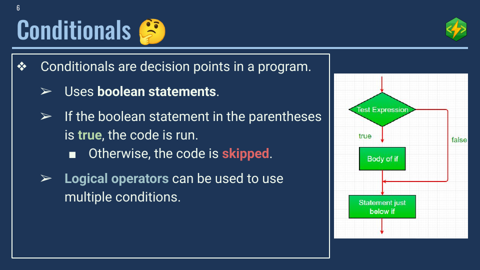

# If Statements

## Objectives

- Use `if`, `else if`, and `else` to choose which code runs
- Order an `else if` ladder correctly
- Nest if statements, and simplify them with logical operators
- Spot the missing-braces and stray-semicolon traps
- Guard against errors like dividing by zero

## Prerequisites

- [Relational and Logical Operators](../../03-operators/02-relational-and-logical-operators/lecture.md)

## Content

### Conditionals

Recall the different errors that can arise in our programs, such as dividing by zero. If we wanted to avoid this, how can we implement this into our program?

Java provides us with **conditionals**. These give us **decision points** in the program to decide what to do.

- Conditionals use **boolean** expressions
- If the boolean expression in the parentheses is `true`, the code inside is run
  - Otherwise, the code is **skipped**
- Logical operators can be used to check multiple conditions



### The if Statement

```java
if (condition) {
    System.out.println("Only runs if condition is true");
}
System.out.println("Runs regardless");
```

If statements allow you to program different paths of computing. This decision making is done through the condition, which must be a **boolean**.

```java
int r = -2;
if (r <= 0) {
    System.out.println("Retype radius above 0");
}
```

### if / else

`else` runs **only if** the `if` condition was `false`. Exactly one of the two blocks will run.

```java
double r = 1.0;
if (r <= 0) {
    System.out.println("Retype radius above 0");
} else {
    System.out.println(r * r * 3.14); // area of the circle
}
```

### else if

When there are more than two paths, chain them with `else if`:

```java
int age = 22;
if (age >= 16) {
    System.out.println("You can drive");
} else if (age >= 21) {
    System.out.println("You can rent a car");
} else {
    System.out.println("You cannot drive");
}
```

- `if` runs if its condition is `true`
- `else if` runs only if every condition before it was `false` **and** its own condition is `true`
- `else` runs if **none** of the conditions were `true`

Run this with `age = 22`. It prints "You can drive", never "You can rent a car". The **first true branch wins** and the rest are skipped. Since every 22-year-old is also `>= 16`, the `age >= 21` branch can never be reached.

**Order matters.** Put the most specific condition first:

```java
if (age >= 21) {
    System.out.println("You can rent a car");
} else if (age >= 16) {
    System.out.println("You can drive");
} else {
    System.out.println("You cannot drive");
}
```

### Nested if Statements

You can put an if statement inside another:

```java
int age = 22;
boolean hasID = true;
if (age >= 18) {
    if (hasID) {
        System.out.println("Entry allowed.");
    } else {
        System.out.println("Old enough, but ID required.");
    }
} else {
    System.out.println("Not old enough");
}
```

The same logic can often be flattened with `&&`:

```java
if (age >= 18 && hasID) {
    System.out.println("Entry allowed.");
} else if (age >= 18 && !hasID) {
    System.out.println("Old enough, but ID required.");
} else {
    System.out.println("Not old enough");
}
```

Use whichever is easier to read.

### Guarding Against Errors

Remember short-circuiting? `&&` skips the right side when the left is `false`. That makes it perfect for preventing a crash:

```java
int dividend = 10;
int divisor = 0;
if (divisor != 0 && dividend / divisor == 2) {
    System.out.println("Runs");
} else {
    System.out.println("Error: divide by zero.");
}
```

And for decimals, compare with a threshold instead of `==`:

```java
double total = 0.1 + 0.2;
if (Math.abs(total - 0.3) < 1e-9) {
    System.out.println("Total is close enough.");
}
```

### Common Traps

**Missing braces.** Without `{ }`, only the **next line** belongs to the if:

```java
boolean loggedIn = false;
if (loggedIn)
    System.out.println("Welcome Back!");
    System.out.println("This prints even though loggedIn is false");
```

The indentation lies! Java ignores it. Always use braces.

**Stray semicolon.** A `;` right after the condition ends the if statement immediately:

```java
int n = -5;
if (n > 0); // <- this semicolon is the whole if statement
{
    System.out.println("This prints, even though n is -5");
}
```

**Using `=` instead of `==`.** `if (x = 5)` doesn't compile, because the condition must be a boolean.

## Further

- **Ternary operator:** a short if/else that produces a value.

  ```java
  String label = (score % 2 == 0) ? "even" : "odd";
  // condition ? value if true : value if false
  ```

- **Dangling else:** without braces, an `else` belongs to the **closest** `if`, not the one it's lined up with. Another reason to always use braces.

## Review

- When does an `else` block run?
- Why does the driving example with `age = 22` never print "You can rent a car"? How do you fix it?
- What prints if you put a semicolon right after `if (n > 0)`?
- How can you check `total / count` without crashing when `count` is 0?

## Exercises

- [Conditionals (Follow Along)](exercises/e01-conditional-demo/prompt.md)
- [Subtraction Quiz](exercises/e02-subtraction-quiz/prompt.md)

### Getting the Files

Open a terminal in your workspace and run:

```bash
ccm get conditional-demo        # Conditionals (Follow Along)
ccm get subtraction-quiz        # Subtraction Quiz
```

Each command creates a folder with that exercise's starter code. To get the whole lesson at once, including every exercise, run `ccm get if-statements`.

Tip: keep your downloads organized by running these inside a folder like `fundamentals`, `week1`, or `hwk` (`mkdir -p fundamentals/hwk`, then `cd` into it). See [Java Workspace](../../01-getting-started/04-java-workspace/lecture.md#keep-your-downloads-organized) for an example.
