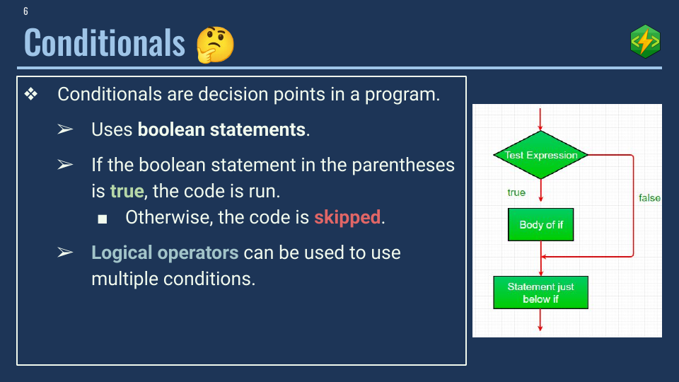

<!-- Original deck: Week 2B - Java Fundamentals (August 21, 2026), slides 10-11 -->

# Conditionals: If Statements & Loops

---

## Conditionals 🤔

- Conditionals are decision points in a program.
  - Uses **boolean statements**.
  - If the boolean statement in the parentheses is **true**, the code is run.
    - Otherwise, the code is **skipped**.
  - **Logical operators** can be used to use multiple conditions.

```java
if (condition) {
    System.out.println("Only runs if condition is true");
}
System.out.println("Runs regardless");
```

---


