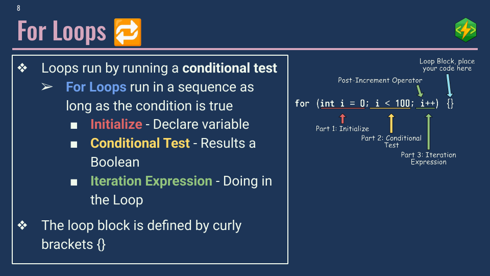

> **Objectives**
> - Write `for` loops and trace their order of execution
> - Count up, count down, and count by steps
> - Nest loops to work with rows and columns
> - Use `break` and `continue`
> - Choose between `for` and `while`
>
> **Prerequisites:** [While Loops](../01-while-loops/lecture.md)

## Follow Along

Get the starter file in Charging Courses Labs with `ccm get for-demo` and open `ForLoops.java`. Write each section's code under its `// --- Section ---` comment and run it. If a name is already used, pick a new one.

## Same Loop, One Line

A counting while loop has three parts in three places:

```java
int k = 0;          // initialization (above the loop)
while (k < 10) {    // condition
    // ...
    k++;            // update
}
```

A `for` loop puts all three in the header:

```java
for (int k = 0; k < 10; k++) {
    System.out.println("Welcome to Java!");
}
```

- **Initialize** - declare the loop variable
- **Conditional test** - results in a boolean; the loop runs while it's true
- **Iteration expression** - what to do after each pass, usually `k++`

The loop block is defined by curly brackets `{ }`.



## Order of Execution

1. The initialization runs **once**
2. The condition is checked. If `false`, stop
3. The body runs
4. The update runs
5. Go back to step 2

```
for ([1]; [2]; [4]) {
    [3];
}
```

A variable declared in the header **only exists inside the loop**. After the loop ends, `k` is gone.

> [!WARNING]
> **Try it:** under `// --- Order of Execution ---`, write a loop from 0 to 2 that prints `"k is " + k`. Then add `System.out.println(k);` **after** the loop. It won't compile, because `k` only exists in the loop. Comment it out.

## Counting Different Ways

```java
for (int k = 5; k >= 1; k--) {
    System.out.print(k + " ");     // 5 4 3 2 1
}

for (int k = 0; k <= 20; k += 5) {
    System.out.print(k + " ");     // 0 5 10 15 20
}
```

Watch out for **off-by-one** errors: `n <= 10` runs ten times starting at 1, `n < 10` runs nine.

## Which Loop Should I Use?

- **for** → I know how many times ("print 10 rows", "1 to 100")
- **while** → I don't ("until the user types 0", "until they guess it")

Either one works. Pick the one that reads better.

## Nested For Loops

A loop inside a loop. The **outer** loop picks a **row**, and the **inner** loop fills that row with **columns**:

```java
for (int row = 1; row <= 9; row++) {
    System.out.print(row + " | ");
    for (int col = 1; col <= 9; col++) {
        System.out.printf("%4d", row * col);
    }
    System.out.println();
}
```

```
1 |    1   2   3   4   5   6   7   8   9
2 |    2   4   6   8  10  12  14  16  18
3 |    3   6   9  12  15  18  21  24  27
...
```

- The inner loop runs start to finish for **every** pass of the outer loop: 9 × 9 = 81 numbers
- The `println()` at the end of the outer loop ends each row
- `printf("%4d", value)` prints a number 4 characters wide so the columns line up

Nesting multiplies: three nested loops of 10,000 each is a **trillion** iterations.

## break and continue

- `break` - exit the loop
- `continue` - skip the **rest** of this pass and go to the next one

```java
// break: stop once the sum reaches 100
int bSum = 0;
for (int n = 1; n <= 20; n++) {
    bSum += n;
    if (bSum >= 100) {
        break;
    }
}
System.out.println("Stopped at sum = " + bSum); // 105

// continue: add only the odd numbers
int cSum = 0;
for (int n = 1; n <= 20; n++) {
    if (n % 2 == 0) {
        continue; // skip the even numbers
    }
    cSum += n;
}
System.out.println("Sum of odds = " + cSum); // 100
```

Lots of `break`s make a loop hard to follow, so use them sparingly. In a nested loop, `break` only exits the **inner** loop.

## Review Quiz

[For Loops Quiz](quiz/review.csv)

## Practice

Write your code in each editor and click **Test Run** until every test passes.

### 1. Multiples

[Multiples](exercises/e02-multiples/prompt.md)

### 2. Factorial

[Factorial](exercises/e03-factorial/prompt.md)

### 3. Star Triangle

[Star Triangle](exercises/e04-star-triangle/prompt.md)

## Homework

### Number Pyramid

[Number Pyramid](exercises/e05-number-pyramid/prompt.md)

### Leap Years

[Leap Years](exercises/e06-leap-years/prompt.md)
