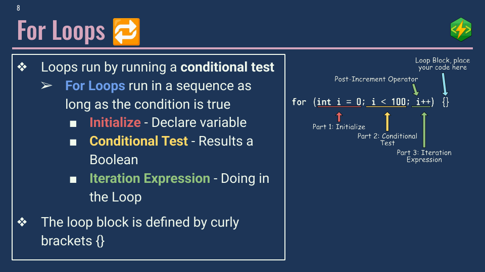

<!-- Original deck: Week 2B - Java Fundamentals (August 21, 2026), slide 13 -->

## For Loops 🔁

- Loops run by running a **conditional test**
  - **For Loops** run in a sequence as long as the condition is true
    - **Initialize** - Declare variable
    - **Conditional Test** - Results a Boolean
    - **Iteration Expression** - Doing in the Loop
- The loop block is defined by curly brackets `{}`

```java
for (int i = 0; i < 100; i++) {
    // Loop block: your code here
}
```

---


