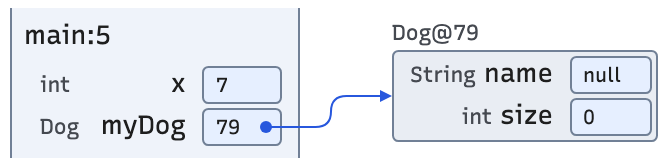
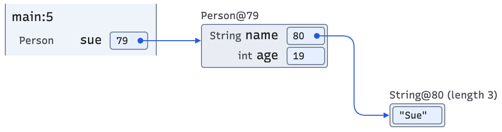
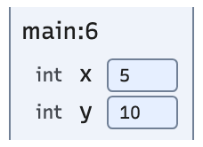
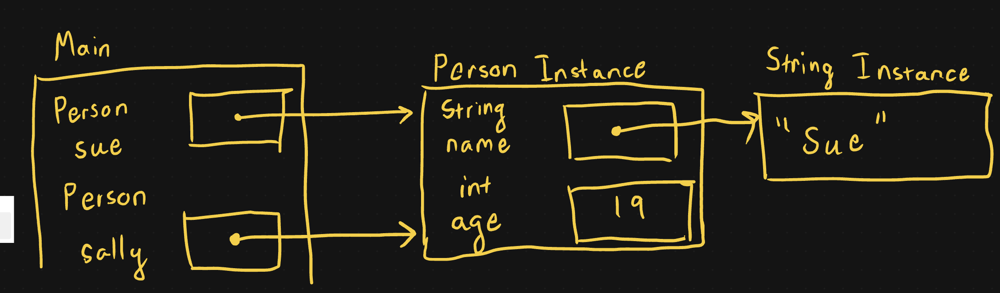
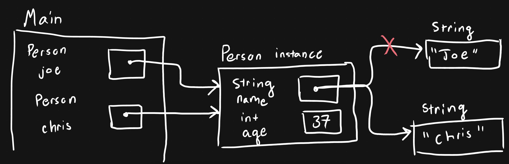
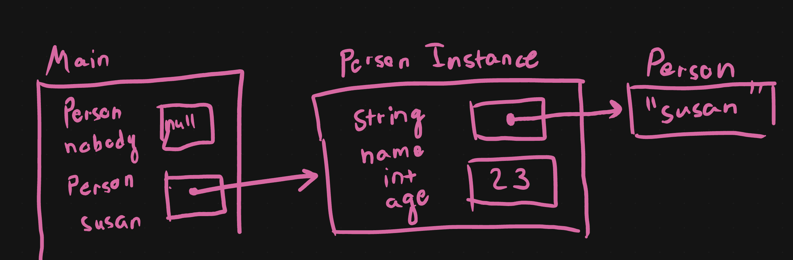
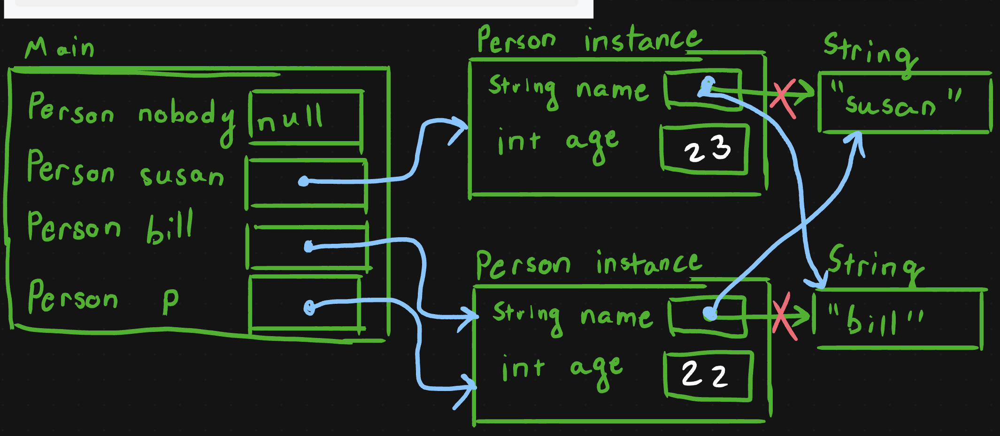
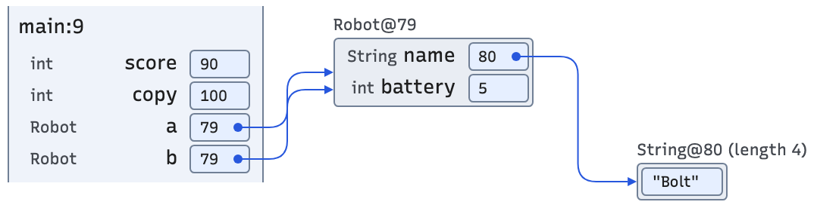
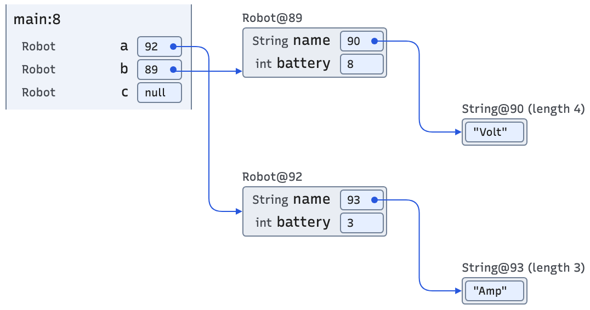
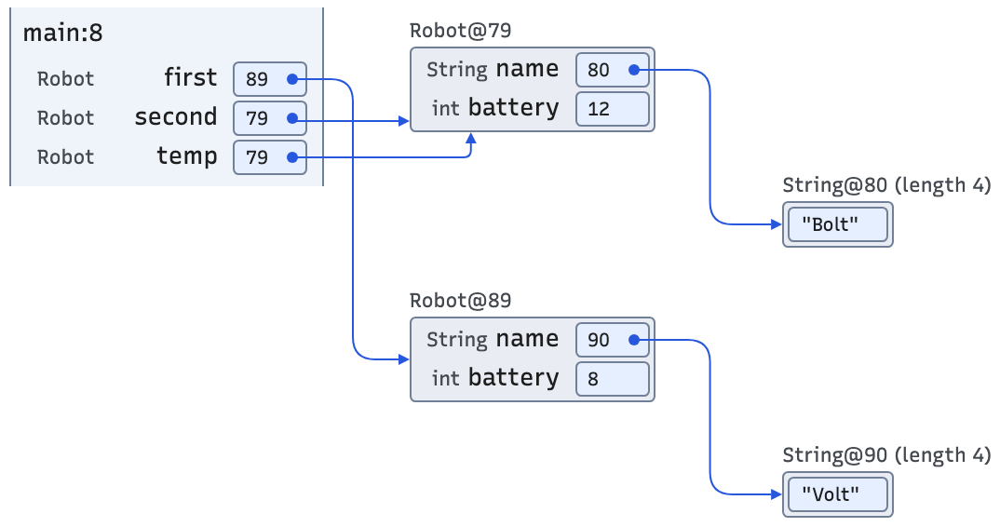

> **Objectives**
> - Tell a primitive variable from a reference variable
> - Explain what a reference variable holds
> - Draw a memory map for code that makes objects
> - Predict what happens when you copy a reference
> - Know what `null` means and when it crashes your program
>
> **Prerequisites:** [Objects](../01-objects/lecture.md)

*Parts of this lesson are adapted from Head First Java (Sierra, Bates & Gee), Chapter 3, and from CSCI 1302 Software Development (Cotterell & Barnes), cs1302book.com.*

*Memory diagrams made with the [CS1302 Code Visualizer](https://github.com/cs1302uga/cs1302-code-visualizer) (Livengood & Cotterell).*

## Warm Up

See how much you already know. Don't worry if you're not sure yet, we'll come back to these.

[Warm Up](quiz/warm-up.csv)

## Follow Along

Write `References.java` along with this lesson. Get the starter files in Charging Courses Labs with `ccm get references-demo`. `Person.java` is already done, you'll just use it. Write each section's code under its matching `// --- Section ---` comment in `References.java`, and run it as you go.

## Variables Review

Variables are containers that store information. They have names, so we can store and get values without needing to know where in memory they are.

You declare a variable with a **type** and a **name**, and you give it a value with `=` (that's **initializing** it):

```java
int x;           // declare
double decimal;

x = 8;           // initialize
decimal = 3.14;
```

Every variable has:

- A **name**: what your code uses to refer to it
- A **type**: tells Java what kind of value it is and how much space it needs
- A **value**: the data it holds right now

## Two Kinds of Variables

A variable in Java holds one of two things:

- **Primitives** hold basic values: whole numbers, decimals, `true`/`false`, characters
- **References** hold a way to get to an **object**

There are only eight primitive types, and they're all lowercase:

| Type | Size | Values |
|---|---|---|
| `boolean` | depends on the JVM | `true` or `false` |
| `char` | 16 bits | 0 to 65535 |
| `byte` | 8 bits | -128 to 127 |
| `short` | 16 bits | -32768 to 32767 |
| `int` | 32 bits | -2147483648 to 2147483647 |
| `long` | 64 bits | -huge to huge |
| `float` | 32 bits | varies |
| `double` | 64 bits | varies |

Anything else is a reference type: `String`, `Scanner`, arrays, and every class you write, like `Cat` or `Person`. Class names start with a capital letter, which is a quick way to spot them.

## Object References

Here's the big idea: **there's no such thing as an object variable.** There's only an object **reference** variable.

```java
int x = 7;
Dog myDog = new Dog();
```

- `x` holds the bits for **7**. The value is right there in the variable.
- `myDog` does **not** hold the dog. It holds bits that represent **a way to get to** the `Dog` object. The object itself lives somewhere else in memory.

Think of a reference variable as a **remote control** for the object. `myDog.bark()` means "use the remote in `myDog` to tell that dog to bark." We don't know exactly what bits are inside a reference, but Java does, and it always leads to one object (or none).

Java is picky about type. A `Dog` remote only works on dogs: you can't put a `Giraffe` reference in a `Rabbit` variable, because what would happen when you ask the "rabbit" to `hop()`?

## Memory Maps

A **memory map** is a drawing of what's in memory at one moment. We'll draw them a lot, so here are the rules:

- Draw a big box for the method that's running (like `main`). Its variables go inside.
- Each variable is a small box with its type and name next to it.
- A **primitive's** value goes right in its box.
- A **reference** box has a dot with an **arrow** to the object it refers to.
- **Objects** go outside the method's box. Each object is a box with its own instance variables inside.
- A `String` is an object too, so a `String` variable gets an arrow to a string object.

Here's `int x = 7;` and `Dog myDog = new Dog();`:



This one was drawn by a tool, so it labels things a little differently than we do on the board. The number in a reference box (like 79) and on the object (`Dog@79`) only tells you **which** object the arrow goes to. It's not a memory address. Also notice the new dog's `name` is `null` and its `size` is `0`: instance variables you don't set get a default value.

## Making an Object

```java
Person sue;
sue = new Person("Sue", 19);
```

Three things happen here, in this order:

1. `Person sue;` makes a variable that can refer to a `Person`
2. `new Person("Sue", 19)` makes a new `Person` object
3. `=` puts the reference to that object in `sue`

`Person` has a **constructor**, which lets you give it a name and age right when you make it. We'll write our own constructors soon. `getName()` gives back the name, and `setName(...)` changes it.



## Copying a Primitive

```java
int x = 5;
int y = x;
y = 10;
System.out.println(x);
```

What prints? `5`. `int y = x;` **copies the value** 5 into `y`. After that, `x` and `y` are two separate boxes, so changing `y` does nothing to `x`.



## Copying a Reference

```java
Person sue = new Person("Sue", 19);
Person sally = sue;
```

`Person sally = sue;` copies what's in `sue`, and what's in `sue` is a **reference**. So now both variables refer to the **same** object. There's still only one person!



Two variables that refer to the same object are called **aliases**.

## Changing an Object Through Another Variable

Since aliases share one object, a change through one shows up through the other. Predict what prints:

```java
Person joe = new Person("Joe", 37);
Person chris = joe;

chris.setName("Chris");
System.out.println(joe.getName());
```

It prints `Chris`. There's only one person, and we changed its name through `chris`. `joe` still refers to that same person.



## null

A reference variable can also hold `null`, which means it refers to **no object**. In a memory map, `null` has no arrow.

```java
Person nobody = null;
Person susan = new Person("Susan", 23);
```



Printing `nobody` is fine, it prints `null`. But using it to call a method crashes your program:

```java
System.out.println(nobody);            // null
System.out.println(nobody.getName());  // crashes: NullPointerException
```

There's no object to ask! This crash is called a **NullPointerException**, and you'll see it a lot. When you do, look for a reference that's `null` when you didn't expect it.

> [!WARNING]
> **Try it:** add `System.out.println(nobody.getName());` to the follow-along. It compiles, but crashes when it runs. Read the error, then comment it out.

> [!INFO]
> Instance variables get a default value if you don't set them: `0` for numbers, `false` for `boolean`, and `null` for references. Local variables (the ones inside a method) don't. Java won't let you use one until you give it a value.

## Putting It Together

Draw the memory map for this, then write down what prints:

```java
Person nobody = null;
Person susan = new Person("Susan", 23);
Person bill = new Person("Bill", 22);
Person p = bill;

susan.setName("Bill");
bill.setName("Susan");

System.out.println(susan.getName());
System.out.println(bill.getName());
System.out.println(p.getName());
System.out.println(nobody);
```



```
Bill
Susan
Susan
null
```

`p` and `bill` refer to the same person, so `p.getName()` gives `Susan` too.

## Review: Draw It

Try each one on paper **before** you look at the answer.

### 1. Copies and Aliases

```java
int score = 90;
int copy = score;
copy = 100;

Robot a = new Robot("Bolt", 12);
Robot b = a;
b.setBattery(5);
```

What's `score`? What's `a.getBattery()`?



`score` is still 90, because `copy` got its own copy of the value. But `a.getBattery()` is **5**: `a` and `b` are aliases, so there's only one robot.

### 2. Moving References

```java
Robot a = new Robot("Bolt", 12);
Robot b = new Robot("Volt", 8);
Robot c = new Robot("Amp", 3);

a = c;
c = null;
```

How many robots are there at the end? Which ones can you still get to?



Three robots were made, but nothing refers to Bolt anymore. `a = c;` moved `a`'s arrow to Amp, and nothing else was pointing at Bolt. An object nothing refers to is **garbage**: you can never get to it again, and Java's **garbage collector** frees up its memory. Amp is still fine, because `a` refers to it even after `c` is set to `null`.

### 3. Swap

```java
Robot first = new Robot("Bolt", 12);
Robot second = new Robot("Volt", 8);

Robot temp = first;
first = second;
second = temp;
```

Which robot does `first` refer to at the end? How many robots got made?



Only two robots, and they never moved or changed. We only moved the arrows: `first` now refers to Volt, and `second` (and `temp`) refer to Bolt.

## Review Quiz

[Object Variables Quiz](quiz/review.csv)

## Practice

Write your code in each editor and click **Test Run** until every test passes. (Or `ccm get` it and work in Labs.)

### 1. Fix the Alias

[Fix the Alias](exercises/e02-fix-the-alias/prompt.md)

### 2. Swap the Robots

[Swap the Robots](exercises/e03-swap-the-robots/prompt.md)

## Homework

### Shared Playlist

[Shared Playlist](exercises/e04-shared-playlist/prompt.md)

## Readings

### Further

- [Reference Type Examples](https://cs1302book.com/java/variables/overview.html), CSCI 1302
- [Reference Types and Assignment](https://cs1302book.com/java/variables/reference-types-and-assignment.html), CSCI 1302
- Head First Java (Sierra, Bates & Gee), Chapter 3: Know Your Variables
- Introduction to Java Programming (Liang), 9.5: Accessing Objects via Reference Variables
