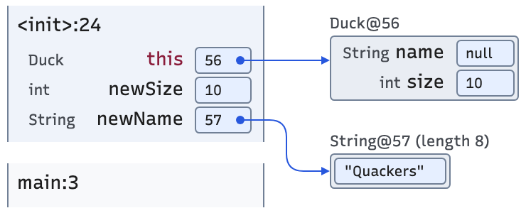
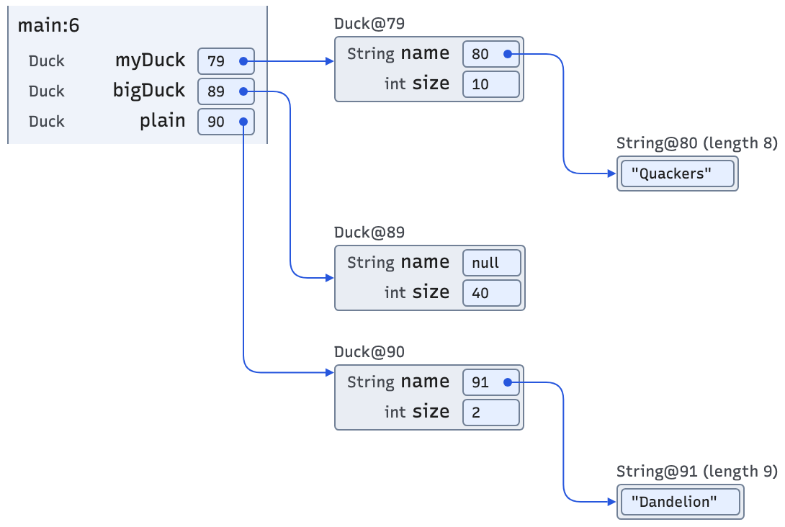

> **Objectives**
> - Explain what a constructor is and when it runs
> - Write constructors that set up an object's state
> - Overload constructors to give more than one way to make an object
> - Use `this` when a parameter has the same name as an instance variable
>
> **Prerequisites:** [Object Behavior](../01-object-behavior/lecture.md)

*Parts of this lesson are adapted from Head First Java (Sierra, Bates & Gee), Chapter 9, and Introduction to Java Programming (Liang), Chapter 9.*

## Follow Along

Write `Duck.java` and `Nature.java` along with this lesson. Get the starter files in Charging Courses Labs with `ccm get duck-demo`. Write each section's code under its matching `// --- Section ---` comment, and run `Nature` as you go.

## Methods Review

Here's a `Circle` that uses everything from last lesson: an instance variable, a setter, a getter, and a method that returns something about the circle.

```java
class Circle {
    double radius;

    void setRadius(double r) {
        radius = r;
    }

    double getRadius() {
        return radius;
    }

    double calculateArea() {
        return 3.14 * radius * radius;
    }
}
```

```java
Circle circle1 = new Circle();
circle1.setRadius(1.0);
double area = circle1.calculateArea();
System.out.println(area);   // 3.14
```

Now look at the first line again:

```java
Circle circle1 = new Circle();
```

`Circle()` has parentheses. Are we calling a method named `Circle`?

## Making an Object

No. We're calling the `Circle` **constructor**.

Remember the three steps of making an object:

```java
Duck d = new Duck();
```

1. `Duck d` declares a reference variable
2. `new Duck()` makes the object. **This is where the constructor runs**
3. `=` links the object to the reference

A **constructor** is the code that runs when you say `new`. It looks a lot like a method, but it isn't one:

- It has the **same name as the class**
- It has **no return type**, not even `void`
- The only way to run it is with `new`

## Where Did the Constructor Come From?

We've been writing `new Cat()` and `new Dog()` without writing any constructors. So where are they?

**Every class has a constructor, even if you don't write one.** If your class has no constructor at all, the compiler adds one for you:

```java
public Duck() {
}
```

This is the **default constructor**. It takes no arguments and does nothing.

## Writing a Constructor

The big thing about a constructor is that it runs **before** the object gets assigned to a reference. You get a chance to step in and get the object ready before anyone can use it.

```java
public class Duck {
    String name;
    int size;

    public Duck() {
        System.out.println("Quack");
        size = 2;
        name = "Dandelion";
    }
}
```

```java
Duck d = new Duck();   // prints Quack
System.out.println(d.name + " is size " + d.size);   // Dandelion is size 2
```

Most of the time, constructors are used to **initialize** the object's state: give its instance variables their starting values.

Here's what memory looks like **while** a constructor is running, in the middle of `new Duck(10, "Quackers")`:



The duck already exists, and the constructor is filling it in. Its `size` has been set, but its `name` hasn't yet. Look at `main`: there's no `myDuck` variable yet. The object isn't linked to a reference until the constructor finishes.

## Why Not Just Use a Setter?

Say every duck needs a size. We could use a setter:

```java
Duck d = new Duck();
d.setSize(42);
```

That works, but for one line the duck exists **without a size**, and whoever uses `Duck` has to remember to call `setSize` every time. How would they even know they need to?

If an object shouldn't be used until some of its instance variables are set, set them in the constructor. A constructor can take parameters, just like a method:

```java
public Duck(int newSize) {
    size = newSize;
}
```

```java
Duck d = new Duck(42);   // made and sized in one step
```

## Overloaded Constructors

What if some people know what size they want, and others don't? You can have more than one constructor. That's called **overloading**:

```java
public class Duck {
    String name;
    int size;

    public Duck() {
        size = 2;
        name = "Dandelion";
    }

    public Duck(int newSize) {
        size = newSize;
    }

    public Duck(int newSize, String newName) {
        size = newSize;
        name = newName;
    }
}
```

```java
Duck myDuck = new Duck(10, "Quackers");
Duck bigDuck = new Duck(40);
Duck plain = new Duck();
```

Java picks which constructor to run based on the arguments you pass. Overloaded constructors **must have different parameter lists**: a different number of parameters, different types, or the same types in a different order. The parameter **names** don't count. Two constructors that each take one `int` won't compile, even if the names are different.



Look at `bigDuck`. Its constructor only set the size, so its name is `null`.

> [!TIP]
> It's a good idea to give people a no-arg constructor with sensible defaults when you can. Then someone who doesn't know what size a duck should be can still make one that works.

## The Compiler Backs Off

Here's a catch. Say `Duck` **only** has this constructor:

```java
public Duck(int newSize) {
    size = newSize;
}
```

Now `new Duck()` won't compile. The compiler only writes the default constructor if you write **no** constructors at all. As soon as you write any constructor, you're in charge of constructors. If you still want a no-arg one, you have to write it yourself.

> [!WARNING]
> **Try it:** comment out the no-arg constructor in `Duck.java` and run `Nature`. Read the error, then put it back.

Another common mistake is putting `void` in front:

```java
public void Duck() {   // this is a method named Duck, not a constructor!
}
```

Java allows it, but it's a method now. It won't run when you say `new`. Don't name methods after the class.

## Default Values

If a constructor doesn't set an instance variable, it keeps its **default value**:

| Type | Default |
|---|---|
| `int`, `double` (any number) | `0` or `0.0` |
| `boolean` | `false` |
| `char` | `'\u0000'` (a blank character) |
| References (`String`, `Duck`...) | `null` |

That's why `bigDuck.name` is `null`. Remember, this is only for instance variables. Local variables don't get defaults.

## this

It's common to name a constructor's (or setter's) parameters the same as the instance variables. But then which `size` is which?

```java
public void setSize(int size) {
    size = size;   // does nothing! both are the parameter
}
```

Inside the method, `size` means the **parameter**, so this just sets the parameter to itself. The instance variable is **hidden** by the parameter.

**`this`** refers to the calling object, the object the method was called on. So `this.size` means "this object's `size`":

```java
public void setSize(int size) {
    this.size = size;   // this object's size = the parameter
}

public Duck(int size, String name) {
    this.size = size;
    this.name = name;
}
```

When you call `bigDuck.setSize(45)`, `this` is `bigDuck`.

## Review Quiz

[Constructors Quiz](quiz/review.csv)

## Practice

Write your code in each editor and click **Test Run** until every test passes. (Or `ccm get` it and work in Labs.)

### 1. Rectangle Class

[Rectangle Class](exercises/e02-rectangle-class/prompt.md)

### 2. Fix the Constructors

[Fix the Constructors](exercises/e03-fix-the-constructors/prompt.md)

## Homework

### Stock Class

[Stock Class](exercises/e04-stock-class/prompt.md)

## Readings

### Further

- Head First Java (Sierra, Bates & Gee), Chapter 9: Life and Death of an Object
- Introduction to Java Programming (Liang), 9.4: Constructing Objects Using Constructors
- Introduction to Java Programming (Liang), 9.14: The this Reference
- [Liang's Chapter 9 exercises, with solutions](https://github.com/HarryDulaney/intro-to-java-programming/tree/master/ch_09)
