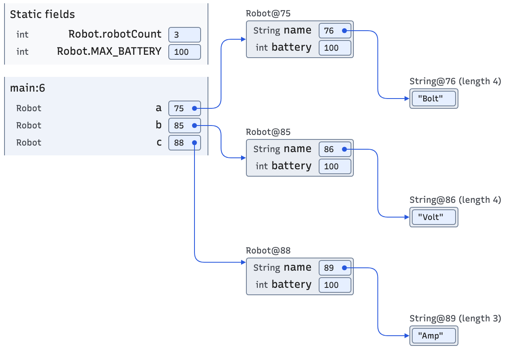

> **Objectives**
> - Explain the difference between static and instance methods and variables
> - Know when a method or variable should be static
> - Make constants with `static final`
> - Use `final` to stop a variable from changing
>
> **Prerequisites:** [Encapsulation](../../03-building-classes/03-encapsulation/lecture.md)

*Parts of this lesson are adapted from Head First Java (Sierra, Bates & Gee), Chapter 10, and Introduction to Java Programming (Liang), 9.7.*

*Memory diagrams made with the [CS1302 Code Visualizer](https://github.com/cs1302uga/cs1302-code-visualizer) (Livengood & Cotterell).*

## Follow Along

Write `StaticTester.java`, `Robot.java` and `Units.java` along with this lesson. Get the starter files in Charging Courses Labs with `ccm get static-demo`. Write each section's code under its matching `// --- Section ---` comment, and run `StaticTester` as you go.

## Methods That Don't Need an Object

You've been using `Math` since Fundamentals:

```java
long rounded = Math.round(42.2);   // 42
int smaller = Math.min(56, 12);    // 12
int distance = Math.abs(-343);     // 343
```

Notice we never made a `Math` object. We call the methods with the **class name**. That's because `round` doesn't depend on any object's state. It rounds the number you give it, and it does the same thing every time. Making a `Math` object just to call it would be a waste.

In fact, you **can't** make one:

```java
Math m = new Math();   // won't compile: Math() has private access
```

The `Math` constructor is `private`, so nobody outside the class can say `new Math()`.

## Static Methods

`Math.round` is a **static** method. The keyword `static` means "this belongs to the **class**, not to any one object." You don't need an object to run it.

You've written static methods before. Every method in Fundamentals was `public static`, and so is `main`. Here's a class of our own that only has static methods:

```java
public class Units {
    public static final double METERS_PER_INCH = 0.0254;

    public static double inchesToMeters(double inches) {
        return inches * METERS_PER_INCH;
    }

    public static double metersToInches(double meters) {
        return meters / METERS_PER_INCH;
    }
}
```

```java
System.out.println(Units.inchesToMeters(100));   // 2.54
```

| | Instance method | Static method |
|---|---|---|
| Belongs to | Each object | The class |
| Call it with | A reference: `myDog.bark()` | The class name: `Math.abs(-5)` |
| Can use instance variables? | Yes | No |
| Example | `getName()`, `deposit(...)` | `Math.min(...)`, `main` |

So when should a method be static? When it doesn't use any instance variables, and never will. Converting inches to meters doesn't depend on any object, so it's static. A robot's `getBattery()` depends on **which** robot, so it isn't.

> [!TIP]
> WPILib has a `Units` class just like ours, with static methods such as `Units.inchesToMeters(...)`. You'll use it in robot code.

## Static Can't Use Instance Variables

A static method runs without any object. So what happens if it tries to use an instance variable?

```java
public class Duck {
    private int size;

    public static void main(String[] args) {
        System.out.println("Size of duck is " + size);   // won't compile
    }
}
```

```
error: non-static variable size cannot be referenced from a static context
```

**Whose** size? There might be ten ducks, or none at all. The static method has no idea which duck you mean. Same goes for calling an instance method, like `getSize()`, from a static method.

The other way around is fine: an instance method can use static variables and call static methods.

> [!WARNING]
> **Try it:** in `Robot.java`, write a static method that prints `name`. Read the error, then delete it.

That's also why your `main` has always had to make an object first (`Cat myCat = new Cat();`) before calling `myCat.meow()`. `main` is static, so it needs a reference to an object to call instance methods.

## Static Variables

Say we want to count how many robots have been made. Would an instance variable work?

```java
private int robotCount = 0;   // an instance variable

public Robot(String name) {
    this.name = name;
    robotCount++;
}
```

No. Each robot gets its **own** `robotCount`, which starts at 0 and goes up to 1 for that robot. We need **one** count that every robot shares. That's a **static variable**:

```java
public class Robot {
    private static int robotCount = 0;
    private String name;

    public Robot(String name) {
        this.name = name;
        robotCount++;
    }

    public static int getRobotCount() {
        return robotCount;
    }
}
```

```java
System.out.println(Robot.getRobotCount());   // 0
Robot a = new Robot("Bolt");
Robot b = new Robot("Volt");
Robot c = new Robot("Amp");
System.out.println(Robot.getRobotCount());   // 3
```

- **Instance variables:** one copy **per object**
- **Static variables:** one copy **per class**, shared by every object



Look at the memory map: each robot has its own `name` and `battery`, but `robotCount` lives with the class, not inside any robot. If one object changes a static variable, every object sees the change.

Static variables get default values just like instance variables do (`0`, `false`, `null`), and they're ready before any object is made. That's why `Robot.getRobotCount()` works before there are any robots.

## Constants

What about a value that should **never** change, like the max battery or pi? Mark it `final`:

```java
public static final int MAX_BATTERY = 100;
```

- **`static`**: there's one for the whole class
- **`final`**: once it has a value, it can never change
- **`public`**: it's fine to let anyone read it, since nobody can change it

`Math.PI` is declared exactly like this: `public static final double PI = 3.141592653589793;`.

Constants are named in **ALL_CAPS** with underscores between words. Give a `static final` variable its value right where you declare it. If you forget, the compiler complains.

```java
Robot.MAX_BATTERY = 200;   // won't compile: cannot assign a value to final variable
```

> [!INFO]
> Every WPILib robot project comes with a `Constants.java` full of `public static final` values: motor ports, controller ports, speeds. If a port changes, you change it in one place. WPILib's own code names constants with a `k` in front, like `kDriverControllerPort`, so you'll see both styles.

## final Variables

`final` works on other variables too. It always means the same thing: **the value can't change once it's set.**

```java
public class Robot {
    private final String name;   // final instance variable

    public Robot(String name) {
        this.name = name;   // set once, here
    }
}
```

A `final` instance variable has to be set when it's declared or in the constructor. After that, not even the class's own methods can change it. It's a stronger version of the read-only trick from Encapsulation.

You can also make a local variable or a parameter `final`. (`final` on methods and classes means something else. We'll see it with inheritance.)

## Review Quiz

[Static and Final Quiz](quiz/review.csv)

## Practice

Write your code in each editor and click **Test Run** until every test passes. (Or `ccm get` it and work in Labs.)

### 1. Ticket Machine

[Ticket Machine](exercises/e02-ticket-machine/prompt.md)

### 2. Unit Converter

[Unit Converter](exercises/e03-unit-converter/prompt.md)

## Homework

### Savings Accounts

[Savings Accounts](exercises/e04-savings-accounts/prompt.md)

## Readings

### Further

- Head First Java (Sierra, Bates & Gee), Chapter 10: Numbers Matter (pp. 276 to 287)
- Introduction to Java Programming (Liang), 9.7: Static Variables, Constants, and Methods
