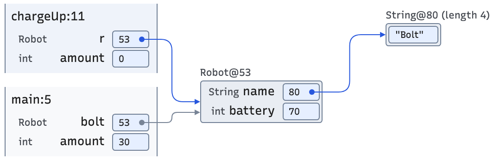
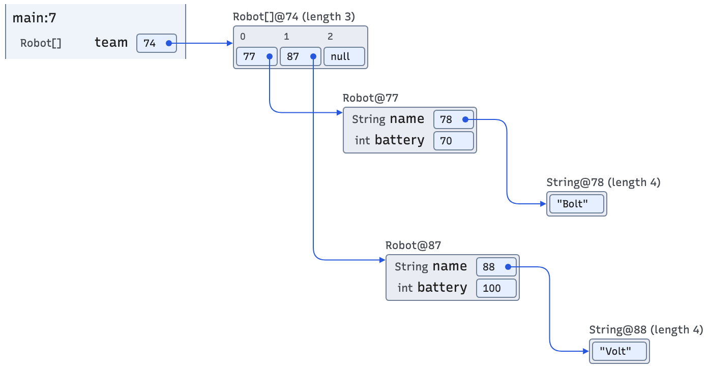

> **Objectives**
> - Explain what happens when you pass an object to a method
> - Tell the difference between changing an object and changing a variable
> - Return an object from a method
> - Make an array of objects and loop over it
> - Use a for-each loop, and know when you need a regular `for` loop instead
>
> **Prerequisites**
> - [Object Variables](../../02-classes-and-objects/02-object-variables/lecture.md)
> - [Static and Final](../01-static-and-final/lecture.md)

*Parts of this lesson are adapted from Introduction to Java Programming (Liang), 9.10 and 9.11.*

*Memory diagrams made with the [CS1302 Code Visualizer](https://github.com/cs1302uga/cs1302-code-visualizer) (Livengood & Cotterell).*

## Follow Along

Write `ObjectsTester.java` along with this lesson. Get the starter files in Charging Courses Labs with `ccm get objects-demo`. `Robot.java` is already done, you'll just use it. Write each section's code under its matching `// --- Section ---` comment, and put the static methods at the bottom of `ObjectsTester`.

## Passing an Object to a Method

Here's a `Robot` with a name and a battery, and a `charge` method that adds to the battery (up to 100). Now a static method in our tester that takes a robot and an `int`:

```java
public static void chargeUp(Robot r, int amount) {
    r.charge(amount);
    amount = 0;
}
```

```java
Robot bolt = new Robot("Bolt", 40);
int amount = 30;
chargeUp(bolt, amount);
System.out.println(bolt.getBattery());   // ?
System.out.println(amount);              // ?
```

Predict both, then run it. It prints `70` and `30`. The robot changed, but `amount` didn't. Why?

Remember from Methods: **Java passes a copy of the value.** That's still true. But think about what the values are:

- `amount` holds `30`, so the method gets a copy of `30`. Changing the copy does nothing to `main`'s `amount`.
- `bolt` holds a **reference** to a robot, so the method gets a copy of the **reference**. `r` and `bolt` are two remotes for the **same** robot.



That's the memory map at the end of `chargeUp`. Two frames, two `amount`s, but only one robot. So when the method changes the robot through `r`, `main` sees it through `bolt`.

## Changing the Object vs Changing the Variable

Here's the catch:

```java
public static void replace(Robot r) {
    r = new Robot("Spare", 100);
}
```

```java
replace(bolt);
System.out.println(bolt.getName());   // ?
```

Still `Bolt`. `r = new Robot(...)` points `r` at a new robot, but `r` is only a copy. `main`'s `bolt` still points at the old one.

- **Calling a method on the parameter** (`r.charge(...)`) changes the object, and the caller sees it
- **Assigning the parameter** (`r = ...`) only changes the method's copy, and the caller never sees it

Same as the swap from Methods: swapping two parameters inside a method doesn't swap anything back in `main`.

## Returning an Object

A method can also make an object and hand it back. The return type is the class:

```java
public static Robot makeSpare(String name) {
    Robot r = new Robot(name, 100);
    return r;
}
```

```java
Robot spare = makeSpare("Volt");
System.out.println(spare.getName() + " has " + spare.getBattery() + "%");   // Volt has 100%
```

The method returns a **reference** to the robot it made. `r` goes away when the method ends, but the robot doesn't, because `spare` refers to it now.

## Arrays Are Objects

Back in Fundamentals we said arrays are objects, and that we'd come back to it. Now you know what that means:

- `new int[5]` makes an array object
- The array variable holds a **reference** to it
- That's why arrays have a `.length` with a dot

So passing an array to a method works just like passing any object. The method gets a copy of the reference, and if it changes what's in the array, the caller sees the change.

## Arrays of Objects

An array can hold objects too:

```java
Robot[] team = new Robot[3];
System.out.println(team[0]);   // null
```

`new Robot[3]` makes an array with three slots, but **no robots**. An array of objects is really an array of **reference variables**, and each one starts as `null`. You have to make each robot yourself:

```java
team[0] = new Robot("Bolt", 70);
team[1] = new Robot("Volt", 100);
```



Using an object from the array takes two steps: `team` leads to the array, and `team[1]` leads to a robot. So `team[1].getName()` means "the robot in slot 1, get its name."

> [!WARNING]
> **Try it:** call `team[2].getName()` before you put a robot in slot 2. It crashes with a NullPointerException: there's no robot there to ask.

You can also fill an array of objects right away with curly braces:

```java
Robot[] team = {
    new Robot("Bolt", 70),
    new Robot("Volt", 100),
    new Robot("Amp", 15)
};
```

## Looping Over Objects

Loop over an array of objects the same way as any array, and call methods on each one:

```java
int total = 0;
for (int i = 0; i < team.length; i++) {
    total += team[i].getBattery();
}
System.out.println("Average battery: " + total / team.length + "%");
```

We never use `i` except to get `team[i]`. When all you need is each item, there's a shorter loop called a **for-each** loop:

```java
int total = 0;
for (Robot r : team) {
    total += r.getBattery();
}
```

Read it as "for each `Robot r` in `team`." Each time through, `r` is the next robot in the array, from first to last. The type before the colon is the type of the items: `for (int score : scores)` for an `int[]`, `for (String name : names)` for a `String[]`.

**Use for-each unless you need the index.** It's shorter, and there's no `i` to get wrong, so no off-by-one mistakes and no going out of bounds. Use a regular `for` loop when you need the index:

- to print or use the slot number (`"Slot " + i`)
- to put something new in a slot (`team[i] = new Robot(...)`)
- to start somewhere other than 0, skip around, or go backward

`r` is a copy of the reference in the slot, just like a method parameter. `r.charge(10)` charges the robot in the array, but `r = new Robot("Spare", 100)` only changes `r`. The array still points to the old robot.

The "highest value" pattern from Fundamentals works too, but now we keep track of the best **object**, not just a number. It starts at index 1, so it uses a regular `for` loop:

```java
public static Robot lowest(Robot[] robots) {
    Robot low = robots[0];
    for (int i = 1; i < robots.length; i++) {
        if (robots[i].getBattery() < low.getBattery()) {
            low = robots[i];
        }
    }
    return low;
}
```

```java
System.out.println("Lowest battery: " + lowest(team).getName());   // Amp
```

If some slots might be `null`, check before you use them: `if (r != null) { ... }`.

## Review Quiz

[Objects in Methods and Arrays Quiz](quiz/review.csv)

## Practice

Write your code in each editor and click **Test Run** until every test passes. (Or `ccm get` it and work in Labs.)

### 1. Charge Them All

[Charge Them All](exercises/e02-charge-them-all/prompt.md)

### 2. Top Scorer

[Top Scorer](exercises/e03-top-scorer/prompt.md)

## Homework

### Match Results

[Match Results](exercises/e04-match-results/prompt.md)

## Readings

### Further

- Introduction to Java Programming (Liang), 9.10: Passing Objects to Methods
- Introduction to Java Programming (Liang), 9.11: Array of Objects
- Head First Java (Sierra, Bates & Gee), Chapter 4, p. 78: passing an object is passing a copy of the remote control
